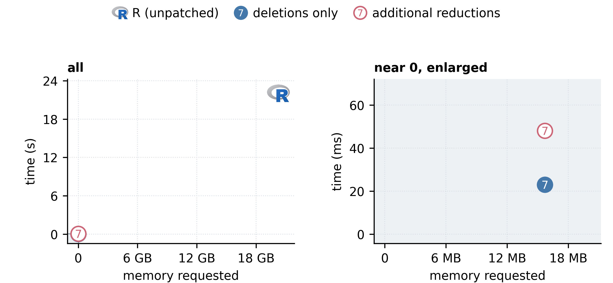
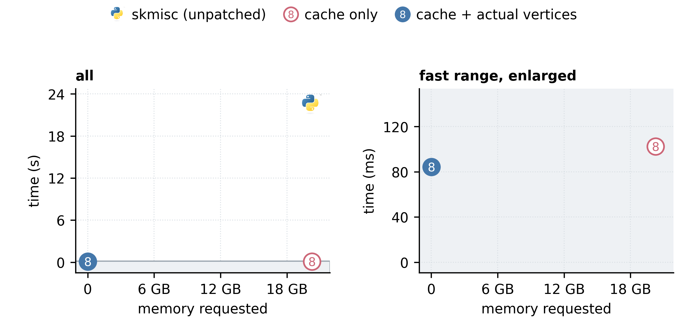

# loesslin

exact standard errors for R's `loess` with memory that grows linearly with the number of observations, for `predict(se = TRUE)` on the interpolation surface.

## experiments

every R build passes the same 275 exactness checks, bit for bit (256 against R, 19 against the cache reference). numbers are against original R at N = 45,000, or on the tied input named. click an experiment for its figures; [how to read them](docs/004-results.md#how-to-read-the-figures).

| experiment | &nbsp;&nbsp;&nbsp;&nbsp;&nbsp;&nbsp;&nbsp;&nbsp;&nbsp;&nbsp;&nbsp;&nbsp;&nbsp;&nbsp;&nbsp;&nbsp;&nbsp;&nbsp;&nbsp;&nbsp;&nbsp;&nbsp;&nbsp;&nbsp;&nbsp;&nbsp;result&nbsp;&nbsp;&nbsp;&nbsp;&nbsp;&nbsp;&nbsp;&nbsp;&nbsp;&nbsp;&nbsp;&nbsp;&nbsp;&nbsp;&nbsp;&nbsp;&nbsp;&nbsp;&nbsp;&nbsp;&nbsp;&nbsp;&nbsp;&nbsp;&nbsp;&nbsp; | memory against&nbsp;R | time against&nbsp;R | source lines against&nbsp;R |
|---|---|---|---|---|
| [exp_000 cache](experiments/exp_000_nov6_cache/README.md) | <a href="docs/assets/exp_000-result.png"></a><br><a href="docs/assets/exp_000-atime.png"></a> | **same** | **153×&nbsp;faster** | +74&nbsp;/&nbsp;−27 |
| [exp_001 actual vertices](experiments/exp_001_actual_vertices/README.md) | <a href="docs/assets/exp_001-result.png"></a><br><a href="docs/assets/exp_001-atime.png"></a> | **1,301×&nbsp;less** | **201×&nbsp;faster** | +176&nbsp;/&nbsp;−82 |
| [exp_002 baseline](experiments/exp_002_baseline_prototype/README.md) | <a href="docs/assets/exp_002-result.png"></a><br><a href="docs/assets/exp_002-atime.png"></a> | **523×&nbsp;less** | **559×&nbsp;faster** | +2,160&nbsp;/&nbsp;−38 |
| [exp_003 reductions](experiments/exp_003_reductions/README.md) | <a href="docs/assets/exp_003-result.png"></a><br><a href="docs/assets/exp_003-atime.png"></a> | **523&nbsp;to&nbsp;1,290×&nbsp;less** | **382&nbsp;to&nbsp;622×&nbsp;faster** | +1,727–2,191&nbsp;/&nbsp;−38–60 |
| [exp_004 worst case](experiments/exp_004_worst_case/README.md) | <a href="docs/assets/exp_004-result.png"></a><br><a href="docs/assets/exp_004-atime.png"></a> | one tied point: **36×&nbsp;less**<br>tied grid: **15×&nbsp;more** | one tied point: **84×&nbsp;faster**<br>tied grid: **23×&nbsp;slower** | +2,160&nbsp;/&nbsp;−38 |
| [exp_005 package source](experiments/exp_005_package_source/README.md) | <a href="docs/assets/exp_005-result.png"></a><br><a href="docs/assets/exp_005-atime.png"></a> | **1,290×&nbsp;less**<br>tied grid: **15×&nbsp;more** | **573×&nbsp;faster**<br>tied grid: **2.0×&nbsp;faster** | +1,253&nbsp;/&nbsp;−59 |
| [exp_006 sparse retention](experiments/exp_006_sparse_retention/README.md) | <a href="docs/assets/exp_006-result.png"></a><br><a href="docs/assets/exp_006-atime.png"></a> | **1,724×&nbsp;less**<br>tied grid: **7.5×&nbsp;more** | **573×&nbsp;faster**<br>tied grid: **1.8×&nbsp;faster** | +1,312&nbsp;/&nbsp;−60 |
| [exp_007 shorter source](experiments/exp_007_shorter_source/README.md) | <a href="docs/assets/exp_007-result.png"></a> | **1,290×&nbsp;less** | **959×&nbsp;faster** | +1,277&nbsp;/&nbsp;−1,748 |

`exp_007` uses `deletions_only`: it saves 1,225 physical package lines without a material one-predictor penalty here. Its additional `reduced` comparison is +1,187 / −1,896 lines against R, but takes 2.00 to 3.88 times the package's one-predictor time; it is not the primary build.

the cache adds 3.06 MB to R's 20.3 GB native request; actual-vertex storage removes unused capacity, not the quadratic worst case. on tied grids R itself needs little memory, so later builds can request more: [details](docs/004-results.md#against-original-r).

source lines are added / removed against original R, without the standalone `register.c` adapter. Counts are physical lines and include copyright and modification notices. `exp_003` gives the range over all eight variants; the other rows name their primary build. `Rscript shared/harness/lines-check.R` recounts this column and fails if it is stale.

## Python® port

[exp_008 Python skmisc](experiments/exp_008_python_skmisc/README.md): the same N = 45,000 input, against unpatched scikit-misc 0.5.3. time is median prediction user CPU; memory is native bytes requested, excluding the unchanged dense influence matrix.

<a href="docs/assets/exp_008-result.png"></a>

| build | memory against unpatched skmisc | time against unpatched skmisc | source lines against scikit-misc 0.5.3 |
|---|---|---|---|
| cache only | **same** | **220×&nbsp;faster** | +57&nbsp;/&nbsp;−20 |
| cache + actual vertices | **1,301×&nbsp;less** | **267×&nbsp;faster** | +161&nbsp;/&nbsp;−75 |

source lines are the final physical differences, including notices, after `cache.patch`, or both patches in order, against the pinned unpatched source (`lines-against-skmisc.csv: variant, added/removed`). Python builds agree bit for bit with each other, not with R; at N = 46,337 the unpatched build crashes. [Scope, licences and Python mark attribution](experiments/exp_008_python_skmisc/README.md).

## compare the methods

after `R CMD INSTALL .` and `Rscript experiments/exp_002_baseline_prototype/run.R` (needs `patch`, `diff` and `jsonlite`), from the repository root:

```r
for (file in c("common.R", "speed.R", "memory.R")) source(file.path("shared", "harness", file))
nov6 <- load_loess("experiments/exp_002_baseline_prototype/.intermediates/reference-nov6", "loesssent.so")
data <- toby_data(20000)                     # the setup of tdhock/atime#135
calls <- list(
  R        = function() predict(data$fit, data$nd, se = TRUE),
  nov6     = function() nov6$predict.loess(data$fit, data$nd, se = TRUE, cache = TRUE),
  loesslin = function() loesslin::predict_se(data$fit, data$nd))
sapply(lapply(calls, function(call) call()), same, calls$R())    # bit for bit
interleaved_seconds(calls, rounds = 3L)                          # user CPU seconds, median
c(R = reference_bytes(1, 20000, 80, 0.5, 2, 0)[["native"]],      # bytes of workspace requested
  nov6 = reference_bytes(1, 20000, 80, 0.5, 2, data$fit$kd$parameter[["nv"]])[["native"]])
```

the [notebook](docs/005-compare.ipynb) does this over N and repeats the R experiments with atime.

## use

one function, on a fit from R's own `loess()`:

```r
x <- runif(2000, -3, 3); y <- sin(x) + rnorm(2000, sd = 0.35)
newdata <- data.frame(x = seq(-2.5, 2.5, length.out = 80))
fit <- loess(y ~ x, span = 0.5)
a <- predict(fit, newdata, se = TRUE)      # R
b <- loesslin::predict_se(fit, newdata)    # this package
identical(a, b)
```

install with `R CMD INSTALL .` (R 4.5 with C and Fortran compilers). early: checked on macOS arm64 with R 4.5.2 only.

Code: [GPL-2 or GPL-3](docs/licences.md). Figure logos: R © The R Foundation, CC-BY-SA 4.0; Python © the Python Software Foundation, used under its trademark policy. [Sources, terms and transformations](docs/licences.md).

## documents

[context](docs/000-context.md) · [results](docs/004-results.md) · [notebook](docs/005-compare.ipynb) · [open questions](docs/002-open-questions.md) · [decisions](docs/001-decisions.md) · [experiment protocol](docs/003-experiment-protocol.md)
