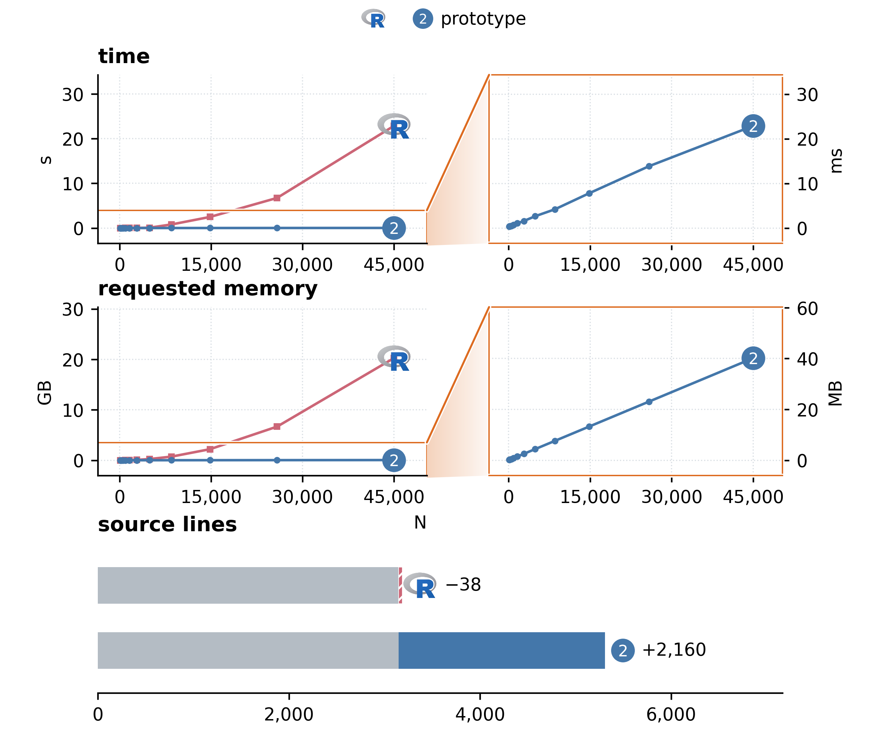

# context

- R's interpolated standard-error workspace can grow quadratically with observations.
- loesslin stores local fits and replays coefficients in R's arithmetic order.
- values, warnings and errors must match R bit for bit.

## limits

- platform, workspace and public-prediction limits are in [results](004-results.md#limits).
- tied grids can request more workspace than R.
- the package has not been built inside R's stats package.
