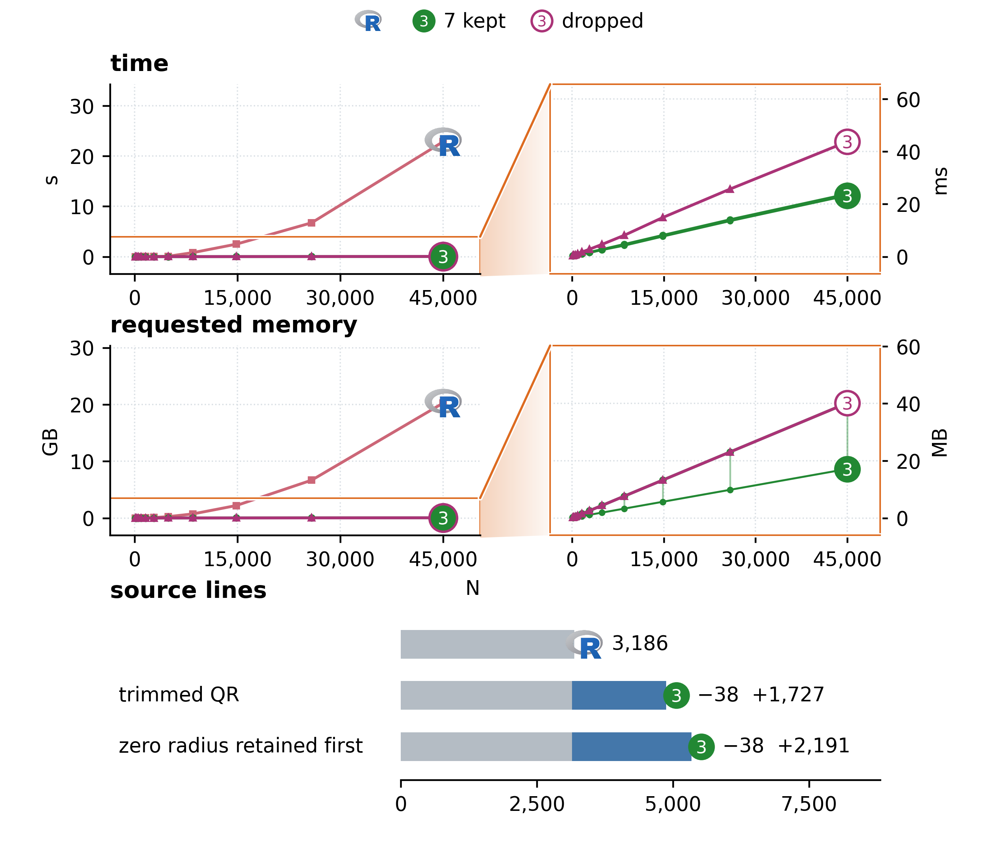

# decisions

- preserve bit-for-bit values, warnings, errors and NaN patterns in the R implementation.
- preserve floating-point and BLAS call order.
- expose `loesslin::predict_se()` without replacing R's installed functions.
- combine the kept prototype reductions into the package.
- prioritise zero-radius vertices in retained fit storage.
- keep sparse retention as a separate candidate.
- use `deletions_only` as the shorter-source result and retain `reduced` as its slower comparison.
- keep the Python port separate from the R package.
- use linear axes and an orange slice zoom in standard figures.
- retain source notices and ship the [licence texts](licences.md).

