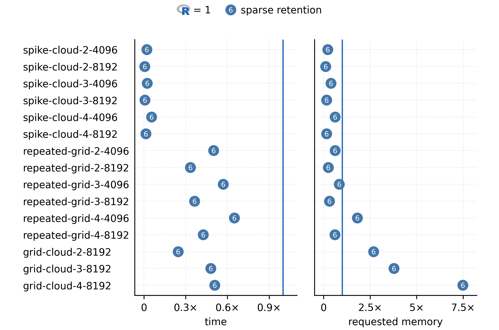

# open questions

- should sparse retention enter the package?
- what causes its remaining workspace excess on tied grids?
- do the constructed tied cases reflect real data?
- can full predictions handle trees as deep as the construction test?
- do the results hold on Linux, x86 and other compilers?

