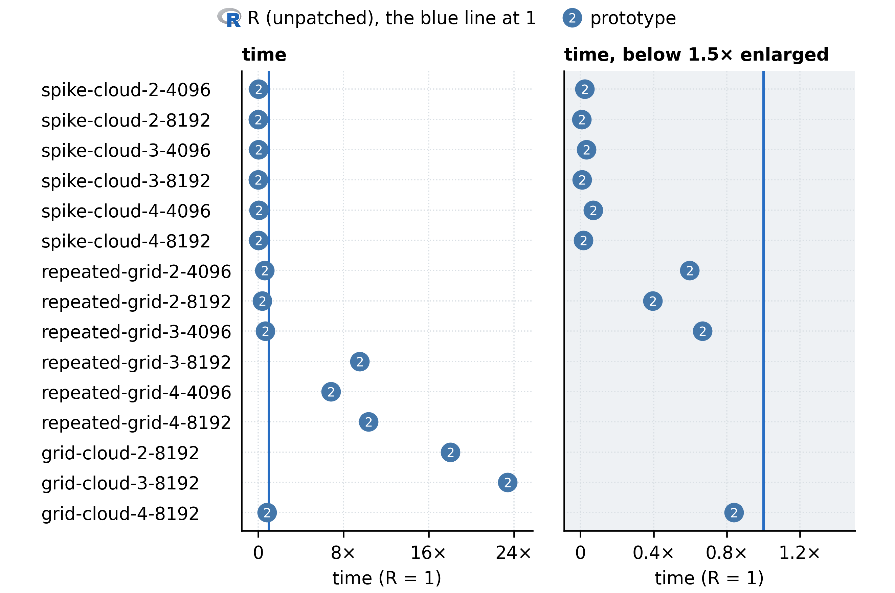
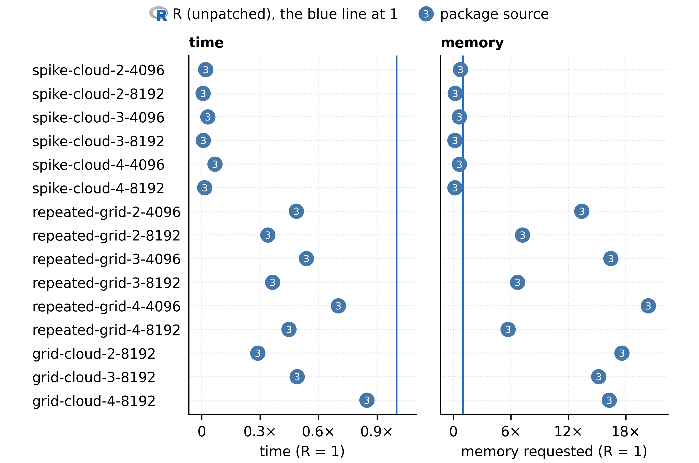
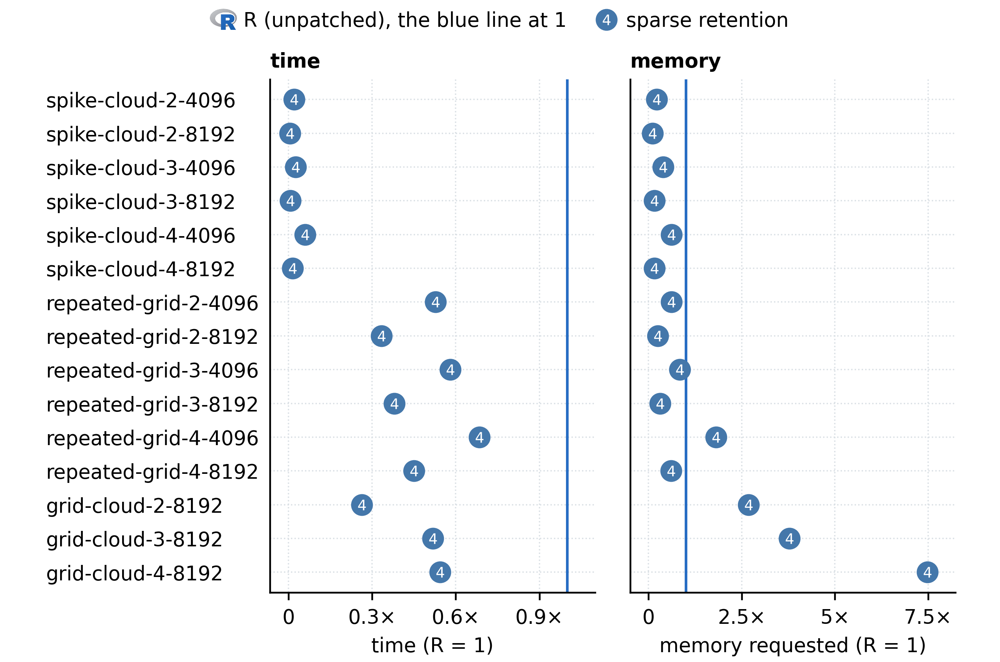

# results

macOS arm64, R 4.5.2. every build passes the 275 shared checks, bit for bit (256 against R, 19 against the Nov 6 patch); the package's own tests compare 324 more predictions (`tests/predict-se.R`). each experiment's page has its full numbers.

## against original R

| input | build | memory | against R | seconds | against R |
|---|---|---:|---:|---:|---:|
| one predictor, N = 45,000 | R | 20.3 GB | | 21.8 | |
| | `exp_000` prototype | 38.7 MB | 523 times less | 0.039 | 559 times faster |
| | `exp_003` package source | 15.7 MB | 1,290 times less | 0.038 | 573 times faster |
| | `exp_004` sparse retention | 11.7 MB | 1,724 times less | 0.038 | 573 times faster |
| `grid-cloud-3-8192` | R | 5.7 MB | | 1.26 | |
| | `exp_002` prototype | 87.0 MB | 15 times more | 29.5 | 23 times slower |
| | `exp_003` package source | 87.0 MB | 15 times more | 0.62 | 2.0 times faster |
| `grid-cloud-4-8192` | R | 7.2 MB | | 1.59 | |
| | `exp_003` package source | 116.8 MB | 16 times more | 1.35 | 1.2 times faster |
| | `exp_004` sparse retention | 53.7 MB | 7.5 times more | 0.86 | 1.8 times faster |

all 15 tied inputs, each build as a multiple of R:

  

- on tied grids R's workspace is small, because its rows are 15 or 31 long, so the builds request more
- R's time on the tied inputs moved by up to 20% between runs, so those ratios are rough
- `predict(se = TRUE)` stops with an error on two tied inputs, in R and in every build, so the native routine is timed directly

## code size

lines against the Nov 6 patched sources: prototype +2044, package source +1130, sparse retention +1181.

## how to read the figures

- upper figure: one input, memory requested across and time up, on linear axes. the R logo is original R, a numbered circle is the build of the experiment with that number, and the right panel enlarges the grey box
- tied figure: a row per tied input, the build as a multiple of R. R is the blue line at 1
- lower figure: R and the builds over N, measured with [atime](https://github.com/tdhock/atime) in the [notebook](005-compare.ipynb)
- memory is the native bytes a call requests. atime's kilobytes panel counts R's allocator instead, so the two do not agree
- the scripts are in `docs/figures/`; they need a local Python helper that is not in this repository, so the images are committed. the R logo is © The R Foundation, CC-BY-SA 4.0
