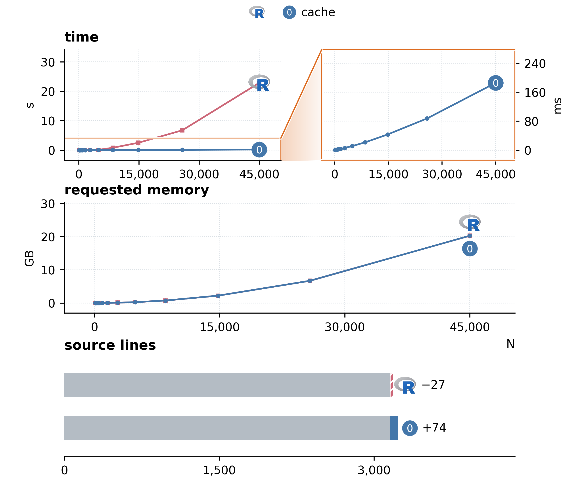
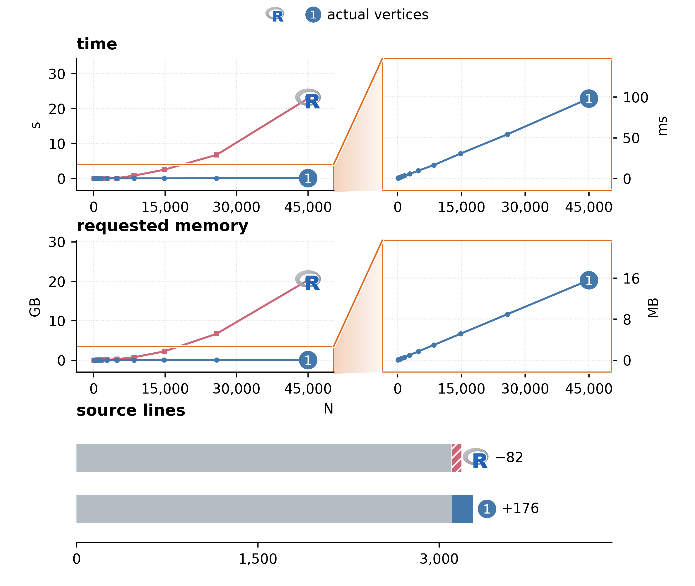
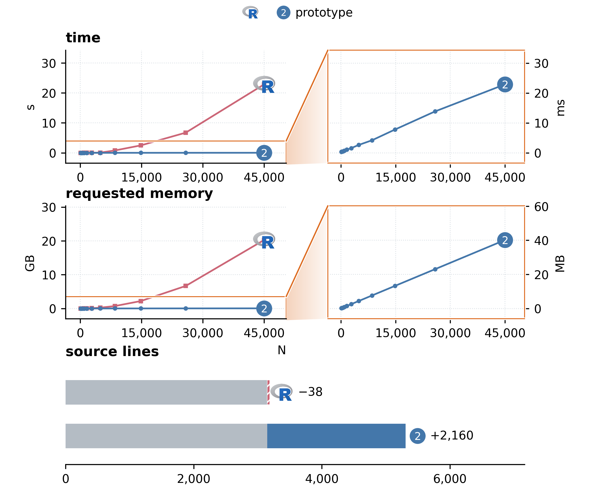
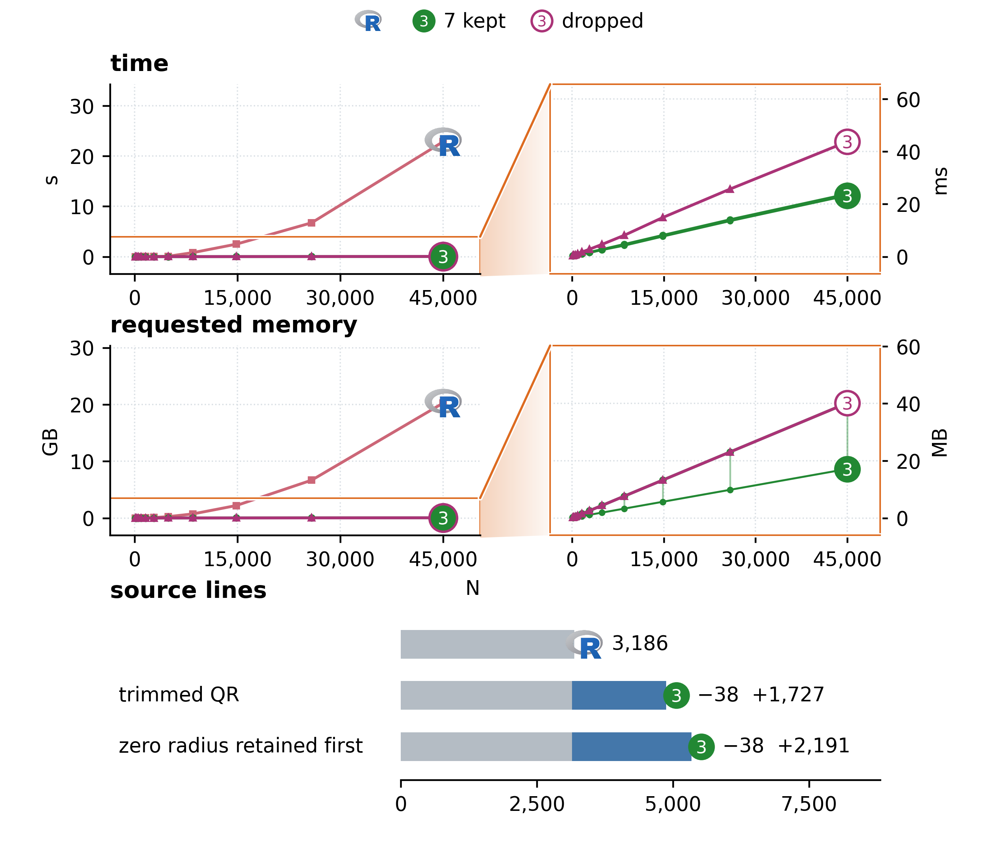
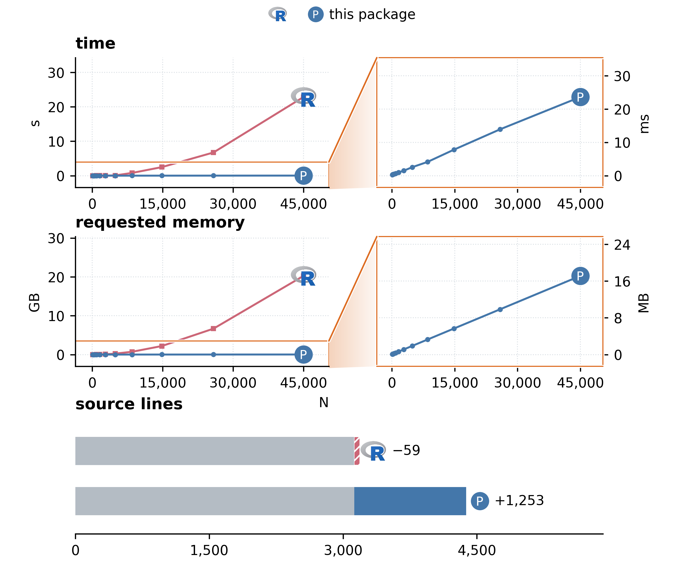
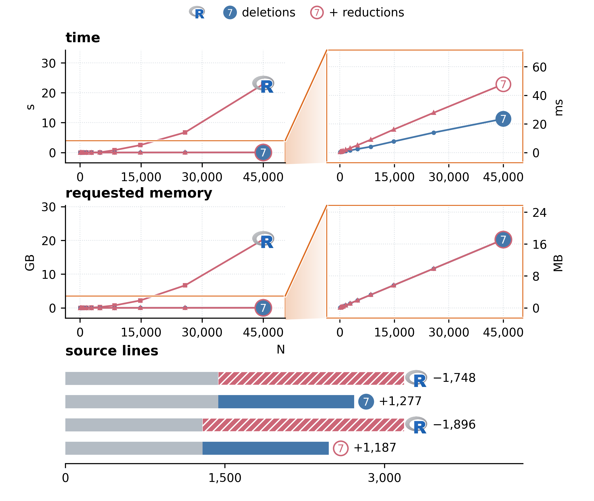
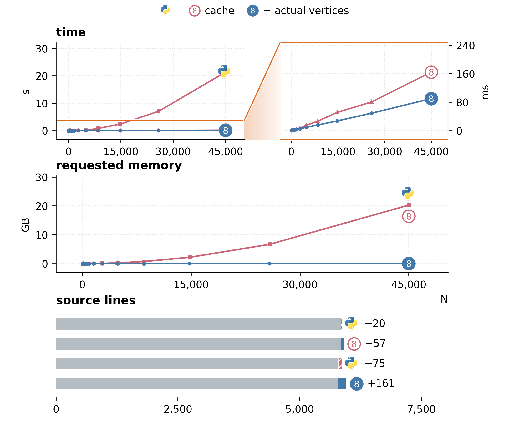

# experiments

| experiment | result | memory against R | time against R | source lines against&nbsp;R |
| --- | --- | --- | --- | --- |
| [exp_000 cache](exp_000_nov6_cache/README.md) |  | same | 123× faster | +74 / −27 |
| [exp_001 actual vertices](exp_001_actual_vertices/README.md) |  | 1,301× less | 233× faster | +176 / −82 |
| [exp_002 baseline](exp_002_baseline_prototype/README.md) |  | 504× less | 999× faster | +2,160 / −38 |
| [exp_003 reductions](exp_003_reductions/README.md) |  | 504–1,182× less | 523–986× faster | +1,727–2,191 / −38–60 |
| [exp_004 worst case](exp_004_worst_case/README.md) |  | 504× less tied grid: 15× more | 978× faster tied grid: 25× slower | +2,160 / −38 |
| [exp_005 package source](exp_005_package_source/README.md) |  | 1,182× less tied grid: 15× more | 968× faster tied grid: 2.0× faster | +1,253 / −59 |
| [exp_006 sparse retention](exp_006_sparse_retention/README.md) |  | 1,601× less tied grid: 7.5× more | 925× faster tied grid: 2.0× faster | +1,312 / −60 |
| [exp_007 shorter source](exp_007_shorter_source/README.md) |  | 1,182× less | 970× faster | +1,277 / −1,748 |

| experiment | result | memory against scikit-misc | time against scikit-misc | source lines against scikit-misc |
| --- | --- | --- | --- | --- |
| [exp_008 Python](exp_008_python_skmisc/README.md) |  | cache: same actual: 1,301× less | cache: 130× faster actual: 238× faster | cache: +57 / −20 actual: +161 / −75 |

figures use elapsed medians and requested workspace with orange zooms; see the [method](../docs/003-experiment-protocol.md).
