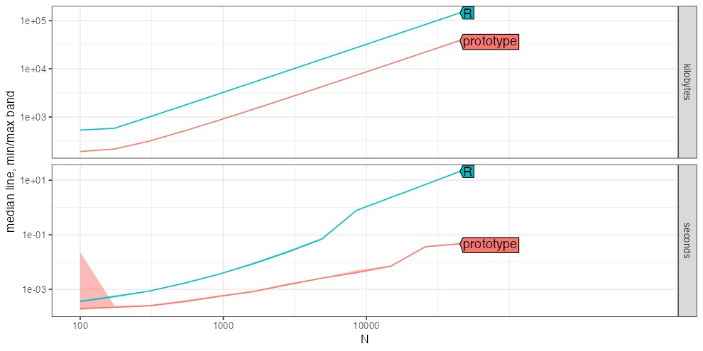
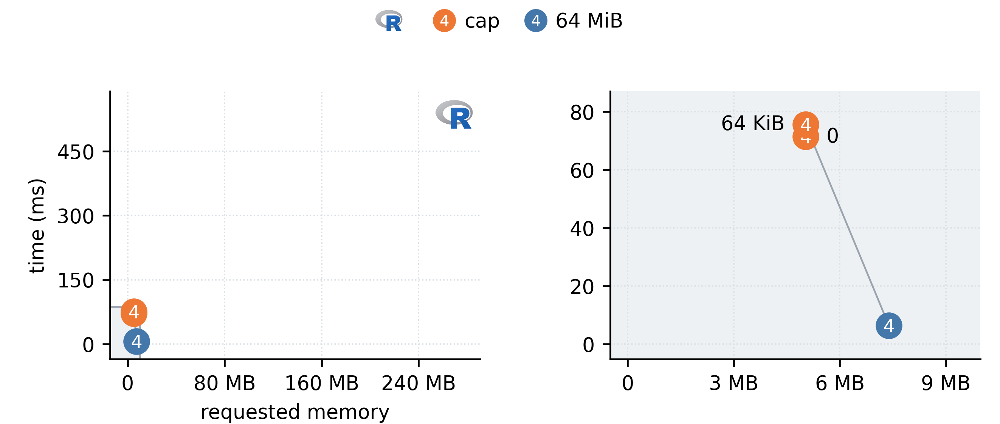
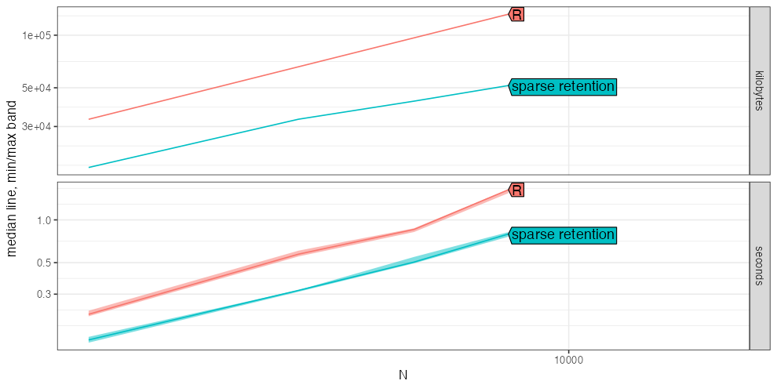

# experiments

every R build passes 275 checks, bit for bit (256 against R, 19 against the cache reference). memory and time at N = 45,000, or on the tied input named; [how to read the figures](../docs/004-results.md#how-to-read-the-figures).

| experiment | &nbsp;&nbsp;&nbsp;&nbsp;&nbsp;&nbsp;&nbsp;&nbsp;&nbsp;&nbsp;&nbsp;&nbsp;&nbsp;&nbsp;&nbsp;&nbsp;&nbsp;&nbsp;&nbsp;&nbsp;&nbsp;&nbsp;&nbsp;&nbsp;&nbsp;&nbsp;result&nbsp;&nbsp;&nbsp;&nbsp;&nbsp;&nbsp;&nbsp;&nbsp;&nbsp;&nbsp;&nbsp;&nbsp;&nbsp;&nbsp;&nbsp;&nbsp;&nbsp;&nbsp;&nbsp;&nbsp;&nbsp;&nbsp;&nbsp;&nbsp;&nbsp;&nbsp; | memory against&nbsp;R | time against&nbsp;R | source lines against&nbsp;R |
|---|---|---|---|---|
| [exp_000 cache](exp_000_nov6_cache/README.md) |   | **same** | **153×&nbsp;faster** | +74&nbsp;/&nbsp;−27 |
| [exp_001 actual vertices](exp_001_actual_vertices/README.md) |   | **1,301×&nbsp;less** | **201×&nbsp;faster** | +176&nbsp;/&nbsp;−82 |
| [exp_002 baseline](exp_002_baseline_prototype/README.md) |   | **523×&nbsp;less** | **559×&nbsp;faster** | +2,160&nbsp;/&nbsp;−38 |
| [exp_003 reductions](exp_003_reductions/README.md) |   | **523&nbsp;to&nbsp;1,290×&nbsp;less** | **382&nbsp;to&nbsp;622×&nbsp;faster** | +1,727–2,191&nbsp;/&nbsp;−38–60 |
| [exp_004 worst case](exp_004_worst_case/README.md) |   | one tied point: **36×&nbsp;less** tied grid: **15×&nbsp;more** | one tied point: **84×&nbsp;faster** tied grid: **23×&nbsp;slower** | +2,160&nbsp;/&nbsp;−38 |
| [exp_005 package source](exp_005_package_source/README.md) |   | **1,290×&nbsp;less** tied grid: **15×&nbsp;more** | **573×&nbsp;faster** tied grid: **2.0×&nbsp;faster** | +1,253&nbsp;/&nbsp;−59 |
| [exp_006 sparse retention](exp_006_sparse_retention/README.md) |   | **1,724×&nbsp;less** tied grid: **7.5×&nbsp;more** | **573×&nbsp;faster** tied grid: **1.8×&nbsp;faster** | +1,312&nbsp;/&nbsp;−60 |
| [exp_007 shorter source](exp_007_shorter_source/README.md) |  | **1,290×&nbsp;less** | **959×&nbsp;faster** | +1,277&nbsp;/&nbsp;−1,748 |

`exp_007` uses `deletions_only`: it saves 1,225 physical package lines without a material one-predictor penalty. Its additional `reduced` comparison is +1,187 / −1,896 lines against R, but takes 2.00 to 3.88 times the package's one-predictor time.

the cache adds 3.06 MB to R's 20.3 GB native request: [details](../docs/004-results.md#against-r).

source lines are added / removed, without the standalone `register.c` adapter. Counts are physical lines and include copyright and modification notices. `exp_003` gives the range over all eight variants; the other rows name their primary build. `Rscript shared/harness/lines-check.R`, from the repository root, recounts this column and fails if it is stale.

the same two changes in Python®, against scikit-misc 0.5.3 at N = 45,000:

| experiment | &nbsp;&nbsp;&nbsp;&nbsp;&nbsp;&nbsp;&nbsp;&nbsp;&nbsp;&nbsp;&nbsp;&nbsp;&nbsp;&nbsp;&nbsp;&nbsp;&nbsp;&nbsp;&nbsp;&nbsp;&nbsp;&nbsp;&nbsp;&nbsp;&nbsp;&nbsp;result&nbsp;&nbsp;&nbsp;&nbsp;&nbsp;&nbsp;&nbsp;&nbsp;&nbsp;&nbsp;&nbsp;&nbsp;&nbsp;&nbsp;&nbsp;&nbsp;&nbsp;&nbsp;&nbsp;&nbsp;&nbsp;&nbsp;&nbsp;&nbsp;&nbsp;&nbsp; | memory against&nbsp;skmisc | time against&nbsp;skmisc | source lines against&nbsp;skmisc |
|---|---|---|---|---|
| [exp_008 Python skmisc](exp_008_python_skmisc/README.md) |  | cache: **same** cache + actual vertices: **1,301×&nbsp;less** | cache: **220×&nbsp;faster** cache + actual vertices: **267×&nbsp;faster** | cache: +57&nbsp;/&nbsp;−20 cache + actual vertices: +161&nbsp;/&nbsp;−75 |

time is median prediction user CPU; memory is native bytes requested, excluding the unchanged dense influence matrix. source lines are the final physical differences, including notices, after `cache.patch`, or both patches in order, against the pinned source (`lines-against-skmisc.csv: variant, added/removed`). Python builds agree bit for bit with each other, not with R; at N = 46,337 scikit-misc crashes. [Scope, licences and Python mark attribution](exp_008_python_skmisc/README.md).
