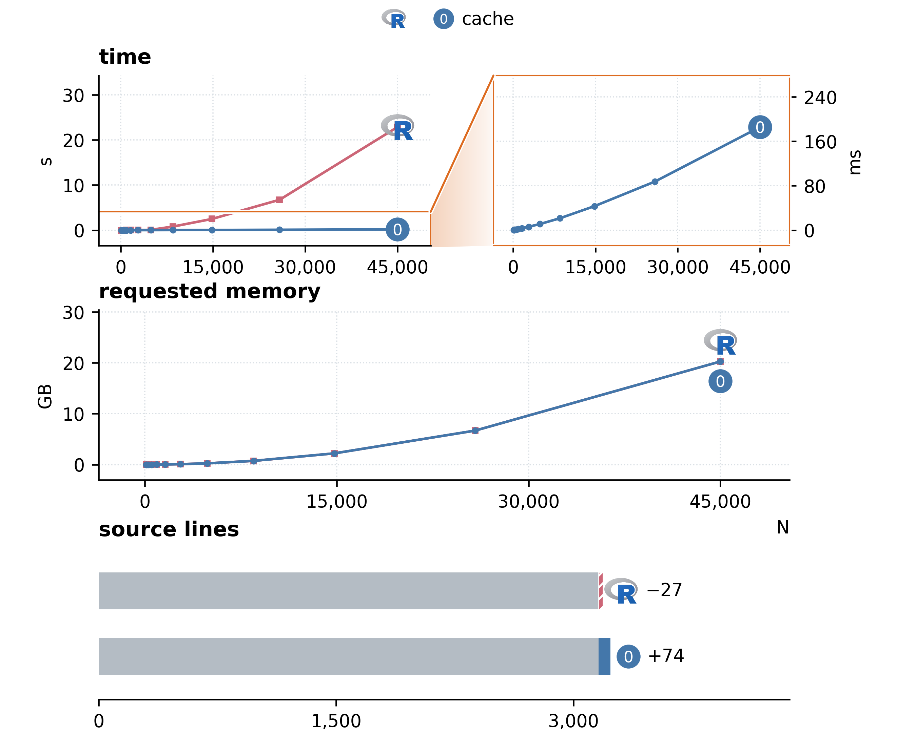

# exp_000 cache

## can cached neighbour lookups speed up exact standard errors?

at N=45,000, the cache is 123× faster and requests 20.26 GB; its coefficient workspace remains quadratic.

[how to run, inputs and outputs](docs/details.md)
