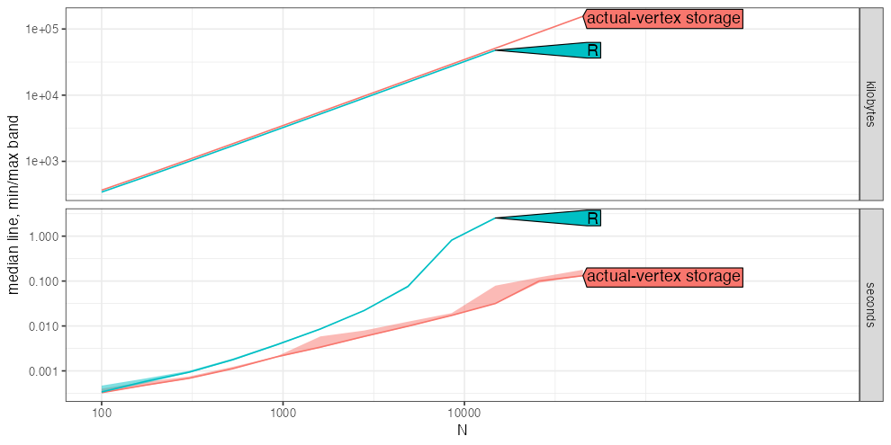

# exp_001_actual_vertices

## question

Can the influence coefficients use the tree's actual vertex count instead of its maximum capacity, without changing the tree, arithmetic or standard-error prediction?

## result

Identical in 275/275 shared checks: 256 against installed R and 19 against the cache reference. All nine timing outputs are also identical to original R.

One predictor, 45,000 observations and 80 prediction points, span 0.5:

| quantity | original R | actual-vertex storage |
|---|---:|---:|
| prediction time, user CPU seconds | 22.893 | 0.114 |
| native bytes requested | 20,254,860,600 | 15,570,600 |
| returned influence matrix, bytes | 28,800,000 | 28,800,000 |

The build is about 201 times faster and requests about 1,301 times fewer native bytes here. The tree has 17 vertices, so storing coefficients for those vertices instead of capacity 45,000 removes most of the unused allocation.

This is not a general linear-memory solution. With small `cell` or tied inputs, the vertex count can grow with the observation count: both the coefficient storage and the inverse-neighbor cache can then remain quadratic. R still constructs the full observation-by-prediction influence matrix, which is square when predicting at every observation. This step adds no bounded retention or replay, and does not reduce exact-fitting allocations or change the direct surface.

One predictor, N = 45,000, against original R:


Toby's setup over N, with R stopped after a call passes one second:



[how to read the figures](../../docs/004-results.md#how-to-read-the-figures)

## how to run

```bash
Rscript experiments/exp_001_actual_vertices/run.R
Rscript shared/harness/lines.R
```

`--no-profile` disables profiling. The entry and its check and timing workers otherwise write separate base-R profiles. Both builds use their source defaults with no preprocessor flags. The run takes several minutes.

<details>
<summary>inputs, outputs and every number</summary>

### inputs

- `shared/reference-nov6/` and `variant.patch`: the cache source plus the actual-vertex allocation change. The geometry phase constructs the same tree at its original capacity. Only then does prediction allocate the neighbor-index array and influence coefficients for the actual vertices. The smoothing and interpolation routines share the original operation order; fitting still uses its original storage dimensions.
- `shared/reference-r/`: original R at the fixed Subversion revision recorded in that folder, verified against R's server.
- `shared/harness/check.R`: unchanged shared inputs for fits, predictions, warnings and errors. The installed R supplies 192 tied and 64 regular checks; the cache reference supplies 16 prediction comparisons and three larger one-predictor comparisons.
- `shared/harness/speed.R:timing_cases` and `timing_data`: the same nine ordinary timing cases used by the later experiments. The large one-predictor case above uses 80 prediction points drawn within the training range, not a separate saved fit.

### outputs

- `.results/json/summary.json`: checks, requested bytes, timings and line changes against original R.
- `.results/tables/checks.csv`, `timing.csv`: one row per shared check or timing case.
- `.results/tables/lines-against-r.csv`: source, standalone `register.c` adapter and total line changes; regenerated by `shared/harness/lines.R`.
- `.results/logs/`, `.results/profile/`: command logs and profiles of the actual workers.
- `.intermediates/src`, `reference-r`, `reference-nov6`: private source and compiled libraries.

### findings and measurement scope

The counts are in `summary.json: checks.cases`, `checks.identical` and `checks.suites`. Times and bytes above are from `timing.csv`, row `case=d1-n45000-m80-cell0.2`, columns `r_s`, `variant_s`, `r_native_bytes`, `native_bytes`, `r_L_bytes` and `L_bytes`; `vertices` gives the actual tree size. The speed and memory factors are `r_s / variant_s` and `r_native_bytes / native_bytes`.

Timing is the median of interleaved calls, reversing build order each round: five rounds for the two largest training sizes, nine for the other cases (`timing.csv: rounds`). It measures the whole public prediction call, including its R-side reduction of the influence matrix; model fitting is outside the timing. `load1` records the shared machine's one-minute load average.

Requested bytes come from `shared/harness/memory.R`, using the source allocation formulas and the fitted tree's vertex count. This build allocates coefficient arrays for the actual vertex count but keeps the original geometry capacity. Native bytes include both workspaces, the coefficients and inverse-neighbor cache. The influence matrix is recorded separately. R input copies, temporary arrays and allocator overhead are excluded; these numbers are not peak resident memory.

There is no memory saving when the actual vertex count equals capacity. In the four-predictor case with 256 observations and 256 vertices, the cache makes the native request larger than R's: 2,506,840 against 2,244,696 bytes (`timing.csv: case=d4-n256-m80-cell0.05`, `vertices`, `native_bytes`, `r_native_bytes`).

Against original R, the built source is +178 / −84 physical lines including the standalone registration adapter, or +176 / −82 without it (`lines-against-r.csv: variant=actual_vertices, part=total/source, added/removed`). Counts include copyright and modification notices. The adapter's initializer name changes only so the standalone library registers under its measurement filename.

The shared checks cover interpolation. They do not add separate direct-surface or exact-fitting regression suites. There is no direct original-R comparison beyond R's workspace limit, and the nine timing inputs do not establish a worst-case memory bound.

</details>
