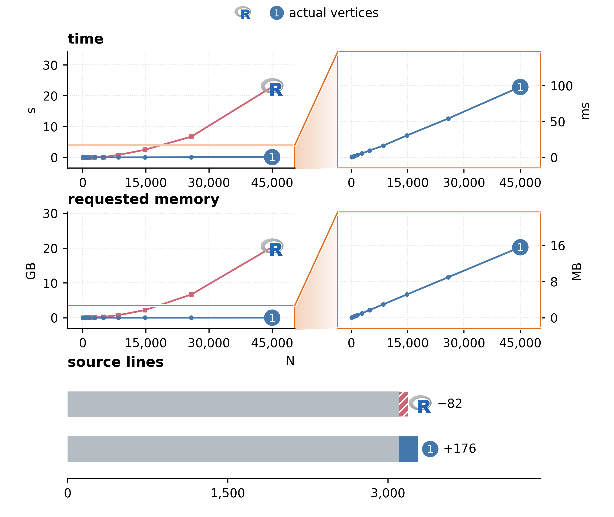

# exp_001 actual vertices

## does actual-vertex storage remove unused coefficient capacity?

at N=45,000, 233× faster and 1,301× less workspace; this is not a general linear-memory solution.

[how to run, inputs and outputs](docs/details.md)
