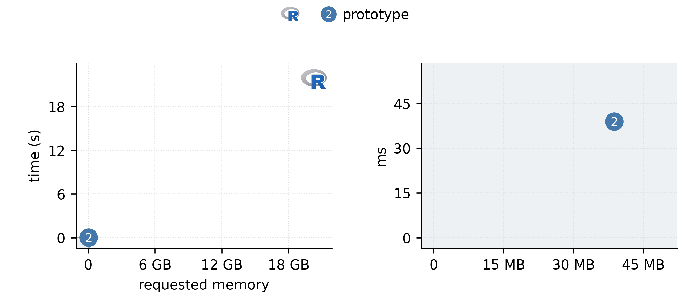
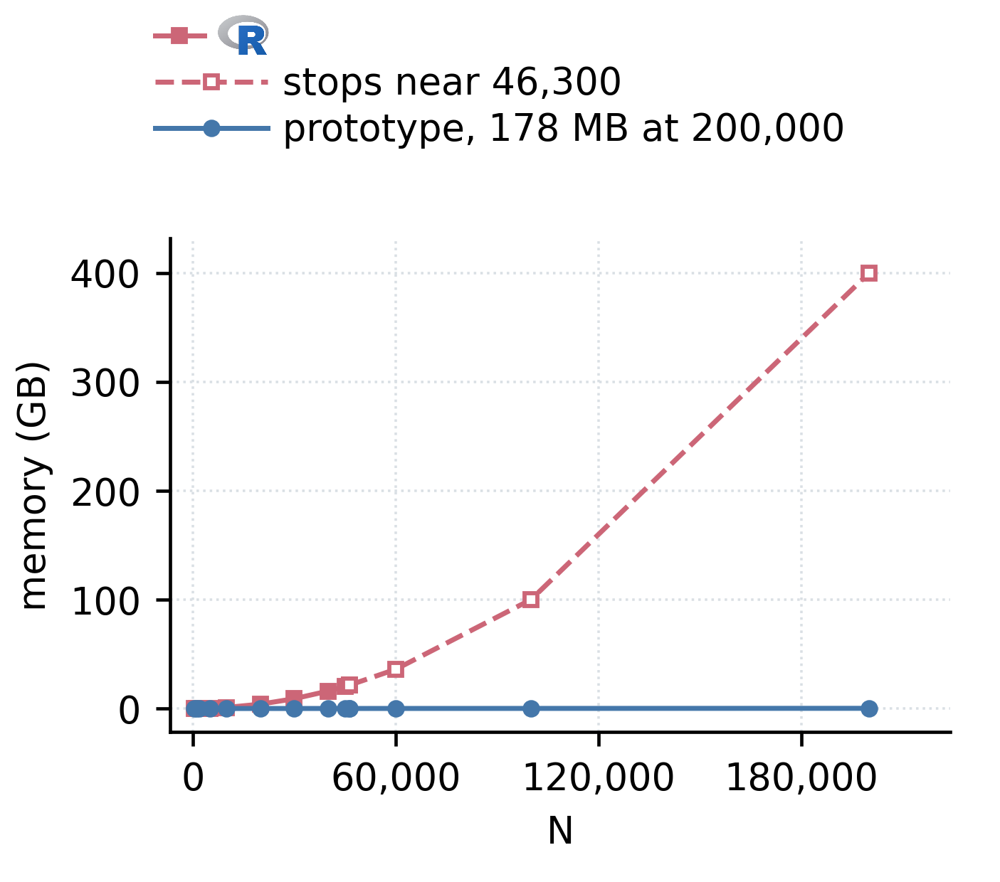
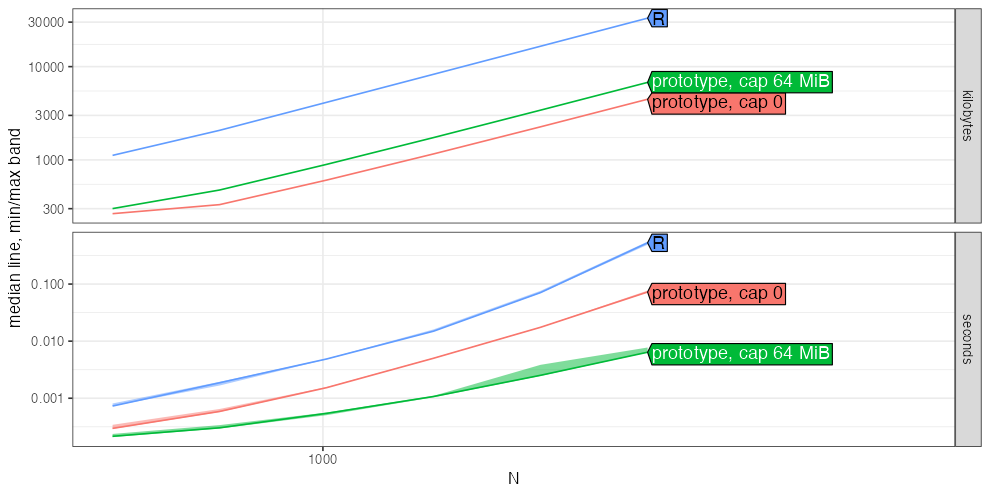

# exp_002_baseline_prototype

## question

Does the unchanged prototype reproduce, and how does its memory grow with N against R's?

## result

Identical in 275/275 checks (256 against R, 19 against the Nov 6 patch). Its memory grows linearly with N; R stops past N = 46,336.

| input | memory | R | | time | R | |
|---|---:|---:|---|---:|---:|---|
| one predictor, N = 45,000 | 38.7 MB | 20.3 GB | **523× less** | 0.039 s | 21.8 s | **559× faster** |







[how to read the figures](../../docs/004-results.md#how-to-read-the-figures)

## how to run

```bash
Rscript experiments/exp_002_baseline_prototype/run.R
```

<details>
<summary>inputs, outputs and every number</summary>

### inputs

`shared/baseline/`, `shared/reference-nov6/`, `shared/harness/`, `src/modules/memory-sweep.R` (memory over N), `src/modules/r-timing.R` (R in the timing cases)

### outputs

`.results/tables/` (checks, timing, `memory.csv`, `r-timing.csv`), `.results/json/summary.json` (keys `memory` and `r_timing` hold those two tables), `.results/logs/`

### findings

275/275 cases identical. +2,160 / −38 physical source lines against R, excluding the standalone `register.c` adapter and including copyright and modification notices (`lines-against-r.csv: variant=prototype, part=source, added/removed`). User CPU is 0.09 to 0.91 of the Nov 6 patch over the 9 timing cases (`summary.json: timing[].ratio`). Native request in the timing case with N = 45,000 and one predictor: 38,732,424 bytes. `timing.csv` also has the bytes the Nov 6 patch requests in each case (`nov6_native_bytes`, its C workspace, and `nov6_L_bytes`, the N by M matrix it returns): the prototype's request is 0.0019 of Nov 6's workspace at N = 45,000 and 0.06 to 1.9 of it in the small cases with 2 to 4 predictors; above 1 only at N = 256 with 4 predictors, where Nov 6's whole workspace is 2.5 MB.

Memory sweep in Toby's setup (one predictor, span 0.5, 80 prediction points across the range of x; `memory.csv`): the native request grows linearly, 479,184 bytes at N = 500, 40,173,184 at N = 45,000 and 178,433,184 at N = 200,000. R's workspace for the same calls is 2,554,600 bytes at N = 500 and 20,254,860,600 at N = 45,000; past N = 46,336 its size no longer fits R's integer length and R stops. Predictions are identical to R's up to N = 20,000, where R still runs in a few seconds.

The two figures at N = 45,000 come from the same build and differ by their inputs: the timing case uses other data and prediction points drawn inside (-2.5, 2.5).

</details>
