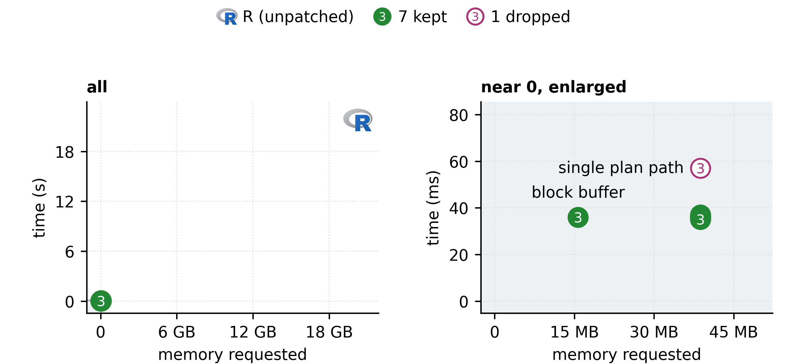
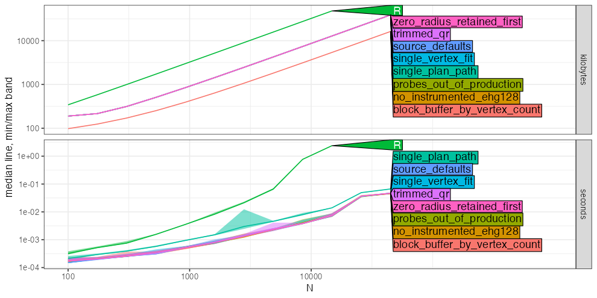

# exp_003_reductions

## question

Which parts of the prototype can go without changing a single output? Eight changes, each applied alone to `shared/baseline/` and measured alone.

## result

All eight are identical in 275/275 checks (256 against R, 19 against the Nov 6 patch). Seven are kept and one is dropped.

| input | memory | R | | time | R | |
|---|---:|---:|---|---:|---:|---|
| one predictor, N = 45,000, the 8 builds | 15.7 to 38.7 MB | 20.3 GB | **523 to 1,290× less** | 0.035 to 0.057 s | 21.8 s | **382 to 622× faster** |





| change | what it does | source lines against R | verdict |
|---|---|---:|---|
| `block_buffer_by_vertex_count` | block buffer sized by the real vertex count | +2,160 / −38 | kept: 38.7 to 15.7 MB |
| `source_defaults` | block width 32 as the source default | +2,160 / −38 | kept |
| `probes_out_of_production` | test probes compiled only in a test build | +2,178 / −38 | kept |
| `trimmed_qr` | two LINPACK copies replaced by one short file | +1,727 / −38 | kept |
| `single_plan_path` | one plan and evaluate path for 1 to 4 predictors | +2,074 / −38 | dropped: 1.5 to 4.3 times slower with one predictor |
| `no_instrumented_ehg128` | no instrumented copy of `ehg128` | +1,763 / −38 | kept |
| `single_vertex_fit` | vertex fit merged into `ehg127` | +2,006 / −60 | kept |
| `zero_radius_retained_first` | zero-radius vertices get the first retention slots | +2,191 / −38 | kept |

The unchanged prototype is +2,160 / −38 source lines against original R. The kept ones together are `exp_005_package_source`. [how to read the figures](../../docs/004-results.md#how-to-read-the-figures)

## how to run

```bash
Rscript experiments/exp_003_reductions/run.R
```

<details>
<summary>inputs, outputs and every number</summary>

### inputs

- `shared/baseline/`, `shared/reference-nov6/`, `shared/harness/`
- `patches/<name>.patch`: the eight changes
- `src/variants.csv`: the order, the verdict of each change with its reason, and which extra checks it runs
- `src/modules/`: the extra cases that reach the changed code of one variant

`--no-profile` turns profiling off. `source_defaults` is built without flags; every other variant uses the measured block width and retention cap.

### outputs

- `.results/tables/reductions.csv`: one row per variant (shown below)
- `.results/tables/<name>-*.csv`, `.results/json/<name>-*.json`: the cases behind each row
- `.results/logs/`, `.results/profile/`: logs, and one profile for the entry and each R worker

### findings

Exactness, bytes and extra checks come from `.results/tables/reductions.csv`. "identical" is the 275 shared cases. Line counts come from `lines-against-r.csv: variant, part=source, added/removed`; they count physical lines against original R, include copyright and modification notices, and exclude the standalone `register.c` adapter. Bytes are the native request at N = 45,000 with one predictor. "extra" counts the variant's own comparisons (`extra_identical`/`extra_cases`, listed in `extra_check_counts`).

| variant | identical | lines | bytes | extra |
|---|---:|---:|---:|---:|
| `block_buffer_by_vertex_count` | 275/275 | +2,160 / −38 | 15,701,128 | |
| `source_defaults` | 275/275 | +2,160 / −38 | 38,732,424 | |
| `probes_out_of_production` | 275/275 | +2,178 / −38 | 38,732,424 (test build) | 419/419 |
| `trimmed_qr` | 275/275 | +1,727 / −38 | 38,732,424 | 75/75 |
| `single_plan_path` | 275/275 | +2,074 / −38 | 38,732,424 | 6/6 |
| `no_instrumented_ehg128` | 275/275 | +1,763 / −38 | 38,732,424 | 19/19 |
| `single_vertex_fit` | 275/275 | +2,006 / −60 | 38,732,424 | 491/491 |
| `zero_radius_retained_first` | 275/275 | +2,191 / −38 | 38,732,424 | 565/565 |

Timing is in the nine `ratio_<case>` columns (variant over Nov 6, user CPU, interleaved). The seven kept variants stay within 1.2 times of each other in every case. `single_plan_path` does not: with one predictor it runs at 0.29, 0.41 and 0.34 of Nov 6 where the other seven run at 0.13 to 0.17, 0.25 to 0.27 and 0.08 to 0.09 (`ratio_d1-*`). Each `<variant>-timing.csv` also has the bytes per case for the variant and for Nov 6 (`native_bytes`, `nov6_native_bytes`); `probes_out_of_production` takes them from its test build.

Costs and limits found by the extra cases:

- `no_instrumented_ehg128`: a point that R flags then needs every vertex. In the one case timed, 130 vertices instead of 10 and 8,275,448 bytes instead of 2,367,608 (`no_instrumented_ehg128-flagged-timing.csv`).
- `probes_out_of_production`: the normal build has 5 registered entries and no test symbol; the test build has 11 (`probes_out_of_production-test-api.json`). Its byte figure comes from the test build, because the normal build has no allocation probe.
- `single_vertex_fit`: the replay path for exceptional vertices is reached in 10 of its 24 tied cases (`single_vertex_fit-replay-cases.json`).
- `zero_radius_retained_first`: at a cap of 65,536 bytes it removes the replays when the zero-radius vertex fits under the cap (128 to 0 at N = 4,096) and cannot when it does not fit (256 to 256 at N = 8,192) (`zero_radius_retained_first-retention-cap-65536.csv`). The case where it matters at the default cap is in `exp_004_worst_case`.

</details>
