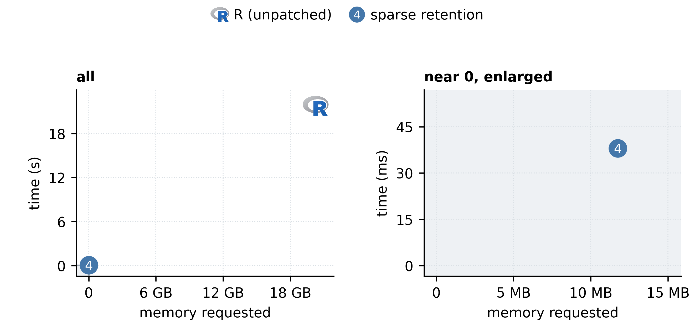
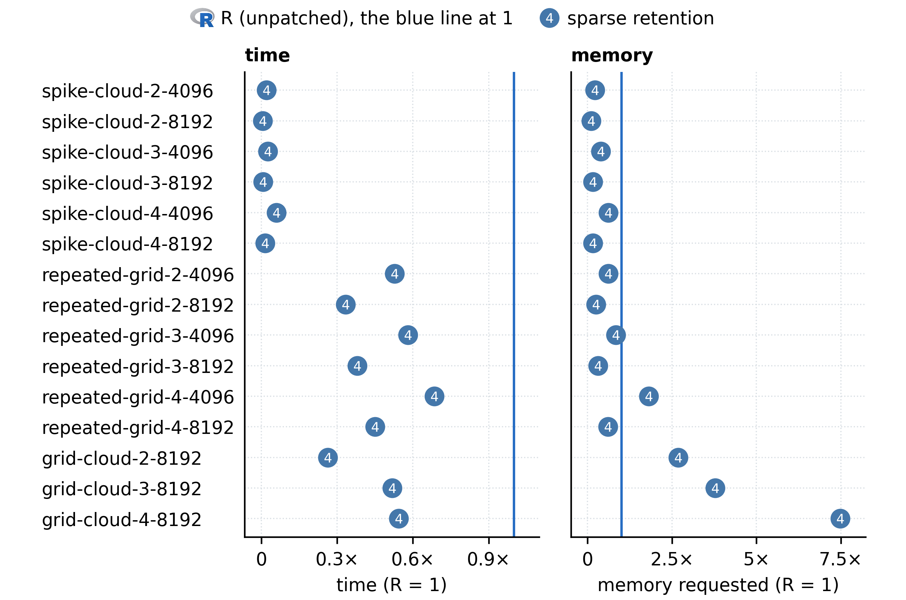
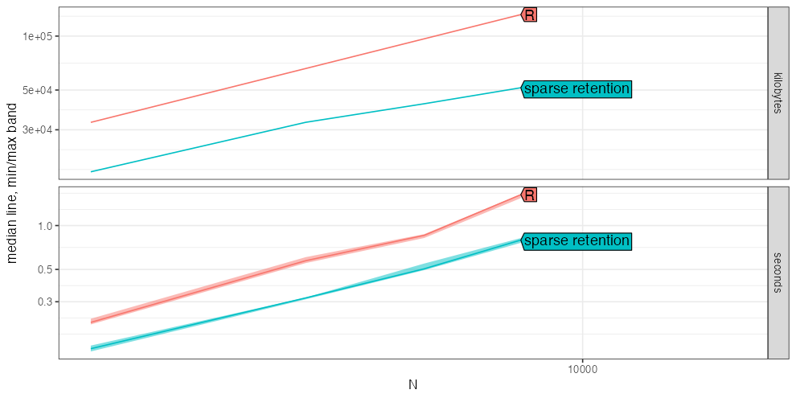

# exp_004_sparse_retention

## question

A retained vertex keeps a row of `N` coefficients, but only the `span * N` observations of its neighbourhood have a nonzero one. Does keeping just those give the same output with less memory, and at what cost in time?

## result

Identical in 275/275 checks (256 against R, 19 against the Nov 6 patch), and faster than R on all 15 tied inputs. It requests less memory than R on 11 of them and 1.8 to 7.5 times more on 4. A candidate, not in the package yet: ordinary inputs measured 0 to 5% slower than the package source on a busy machine.

| input | memory | R | | time | R | |
|---|---:|---:|---|---:|---:|---|
| one predictor, N = 45,000 | 11.7 MB | 20.3 GB | **1,724× less** | 0.038 s | 21.8 s | **573× faster** |
| tied grid `grid-cloud-4-8192` | 53.7 MB | 7.2 MB | **7.5× more** | 0.86 s | 1.59 s | **1.8× faster** |

On the tied grid a neighbourhood has 15 points, so R's own workspace is small; what sparse retention still requests beyond R is not located yet. R was timed in a separate run, so its time ratio is rough.

One predictor, N = 45,000:



The 15 tied inputs, against R:



`grid-cloud-4` over N:



[how to read the figures](../../docs/004-results.md#how-to-read-the-figures)

## how to run

```bash
Rscript experiments/exp_004_sparse_retention/run.R
```

<details>
<summary>inputs, outputs and every number</summary>

### inputs

`shared/baseline/`, `shared/reference-nov6/`, `shared/harness/` (tied cases in `tied.R`, their worker in `tied-worker.R`), this folder's `variant.patch` and the patch of `exp_003_package_source`.

`variant.patch` is the package source (`exp_003_package_source/variant.patch`) with this one change: a retained vertex stores its `nf = span * N` coefficients per component and their row numbers, ordered by coefficient block. The before side is the package source itself.

`--no-profile` turns profiling off. Both builds use the source defaults, with no flags. Bytes and vertex counts come from separate copies built with the test probes; the probes are not in the normal build. The run takes about 15 minutes.

### outputs

- `.results/json/summary.json` (the comparison is under `against_before`, the checks at three small caps under `cap_checks`) and `.results/json/before-summary.json`
- `.results/tables/checks.csv`, `checks-cap-0.csv`, `checks-cap-4096.csv`, `checks-cap-65536.csv`, `timing.csv`, and `before-checks.csv`, `before-timing.csv`
- `.results/tables/timing-comparison.csv`: the nine ordinary timing cases, before and after, one row per case
- `.results/tables/tied-comparison.csv`: the 15 tied cases, before and after, one row per case
- `.results/logs/`, `.results/profile/`

### findings

Run of 2026-11-12, on a busy machine (load 36 to 69 during the timing).

- 275/275 shared cases identical with the source defaults, and 275/275 at retention caps of 0, 4,096 and 65,536 bytes, where slots are reused and taken over (`summary.json: checks`, `cap_checks`). The before side: 275/275.
- Tied inputs: 15/15 identical in both builds (`tied-comparison.csv`).
- Lines against the Nov 6 sources: +1181 -46, against +1130 -46 for the package source (`summary.json: lines`, `before.lines`).
- Memory requested, ordinary timing cases: 0.75 to 0.90 of the package source; one predictor at N = 45,000 goes from 15.7 MB to 11.7 MB (`timing-comparison.csv`).
- Time, ordinary timing cases: 1.00 to 1.05 of the package source in all nine, so a little slower. An earlier run of five of them on the same builds gave 1.00 to 1.06.
- Tied cases: 0.56 to 0.94 of the package source's time, and 0.40 to 0.80 of the Nov 6 time. No case is slower than the Nov 6 patch any more; before, `grid-cloud-4-8192` was.
- Every needed vertex is retained in 12 of the 15 tied cases, against 3 before.

The 15 tied cases (`tied-comparison.csv`; seconds are user CPU of the native routine, the last column is against Nov 6):

| case | vertices needed | retained before | after | `nf` | MB before | after | seconds before | after | ratio after |
|---|---:|---:|---:|---:|---:|---:|---:|---:|---:|
| spike-cloud-2-4096 | 775 | 682 | 775 | 819 | 69.5 | 20.2 | 0.10 | 0.09 | 0.40 |
| spike-cloud-2-8192 | 786 | 341 | 786 | 1,638 | 70.0 | 39.1 | 0.21 | 0.17 | 0.42 |
| spike-cloud-3-4096 | 1,357 | 512 | 1,357 | 819 | 74.3 | 47.2 | 0.32 | 0.24 | 0.42 |
| spike-cloud-3-8192 | 1,338 | 256 | 1,138 | 1,638 | 75.0 | 75.0 | 0.64 | 0.50 | 0.43 |
| spike-cloud-4-4096 | 2,747 | 409 | 1,862 | 819 | 91.4 | 91.5 | 1.22 | 1.00 | 0.59 |
| spike-cloud-4-8192 | 2,570 | 204 | 931 | 1,638 | 91.1 | 91.4 | 2.29 | 2.02 | 0.64 |
| repeated-grid-2-4096 | 289 | 289 | 289 | 15 | 29.6 | 1.4 | 0.04 | 0.04 | 0.56 |
| repeated-grid-2-8192 | 289 | 289 | 289 | 31 | 58.5 | 2.0 | 0.07 | 0.06 | 0.51 |
| repeated-grid-3-4096 | 343 | 343 | 343 | 15 | 47.2 | 2.4 | 0.06 | 0.05 | 0.65 |
| repeated-grid-3-8192 | 343 | 256 | 343 | 31 | 70.0 | 3.3 | 0.11 | 0.09 | 0.57 |
| repeated-grid-4-4096 | 625 | 409 | 625 | 15 | 73.1 | 6.5 | 0.15 | 0.13 | 0.69 |
| repeated-grid-4-8192 | 625 | 204 | 625 | 31 | 73.8 | 7.8 | 0.27 | 0.22 | 0.63 |
| grid-cloud-2-8192 | 2,611 | 341 | 2,611 | 15 | 77.8 | 11.9 | 0.42 | 0.33 | 0.46 |
| grid-cloud-3-8192 | 3,212 | 256 | 3,212 | 15 | 87.0 | 21.7 | 0.70 | 0.65 | 0.80 |
| grid-cloud-4-8192 | 5,699 | 204 | 5,699 | 15 | 116.8 | 53.7 | 1.55 | 0.86 | 0.71 |

`grid-cloud-4-8192` is the input `exp_003_package_source` left at 1.1 to 1.3 times the Nov 6 time: 1.55 s there, 0.86 s here, against 1.21 s for Nov 6, with all 5,699 vertices retained instead of 204.

Where it does not help: with a large span and many vertices (three `spike-cloud` cases, span 0.2) the cap is still reached, so the bytes stay the same; the cap then holds 4 to 5 times more vertices and the time falls by 12 to 22%.

What it costs: 51 more source lines, and 0 to 5% more time on the ordinary cases, where every vertex was retained already. That number is from a busy machine and needs a quiet rerun before the change is taken into the package source.

The experiment times the Nov 6 patch on the tied inputs; `docs/figures/result/r-tied.R` measures R on all of them.

</details>
