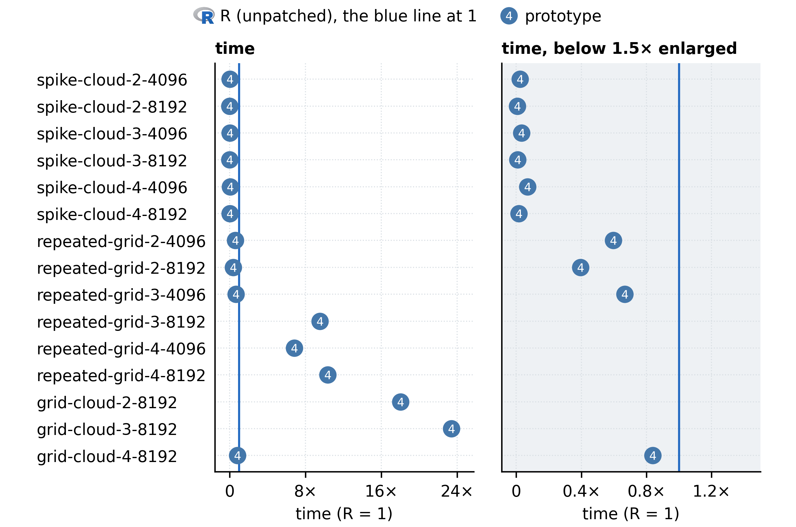
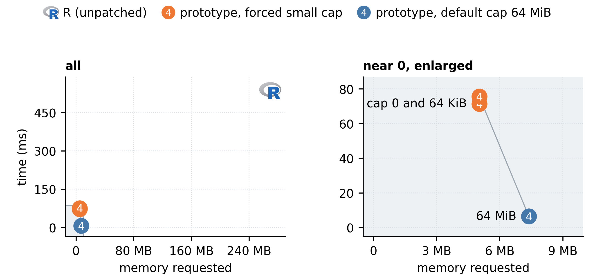
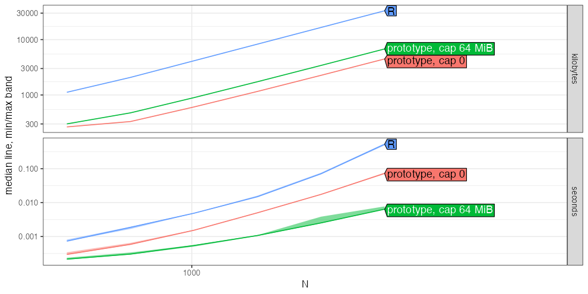

# exp_004_worst_case

## question

Where is the prototype slowest: many fits redone because the retention cap is too small, deep trees, or inputs with many tied rows?

## result

Identical in every check. Tied inputs are the worst case: on 5 of 15 the prototype takes 7 to 23 times R's time.

| input, N = 8,192 | memory | R | | time | R | |
|---|---:|---:|---|---:|---:|---|
| half of x tied at one point | 7.4 MB | 269 MB | **36× less** | 0.006 s | 0.54 s | **84× faster** |
| tied grid `grid-cloud-3-8192` | 87.0 MB | 5.7 MB | **15× more** | 29.5 s | 1.26 s | **23× slower** |

On the tied grid a neighbourhood has 15 points, so R's own workspace is small. R was timed in a separate run, so its time ratios are rough.

The 15 tied inputs, the prototype's time against R:



Half of x tied at one point, at three caps:





`exp_005_package_source` fixes the 5 slow inputs. [how to read the figures](../../docs/004-results.md#how-to-read-the-figures)

## how to run

```bash
Rscript experiments/exp_004_worst_case/run.R
```

<details>
<summary>inputs, outputs and every number</summary>

### inputs

`shared/baseline/`, `shared/reference-nov6/`, `shared/harness/` (the tied cases are in `shared/harness/tied.R`). No patch. `--no-profile` turns profiling off. The run takes about 20 minutes.

### outputs

- `.results/tables/worst-cap-<bytes>.csv`: retention stress at four caps (64 MiB, 1 MiB, 64 KiB, 0)
- `.results/tables/depth.csv`: tree depth
- `.results/tables/default-cap-findings.csv`, `tied-cap-<bytes>.csv`: tied inputs at the default cap, with the cap 0 control
- `.results/tables/checks*.csv`, `timing.csv`: the shared checks at each cap
- `.results/json/summary.json`: keys `build_checks`, `worst_case`, `depth`, `tied_default_cap`
- `.results/logs/`, `.results/profile/`

### findings

The prototype is +2,160 / −38 physical source lines against original R, excluding the standalone `register.c` adapter and including copyright and modification notices (`lines-against-r.csv: variant=prototype, part=source, added/removed`).

Ratios are prototype over Nov 6 in user CPU; the machine is shared, so they move between runs. Everything is identical: 275/275 shared cases at each of the four caps, 21/21 stress cases, 4/4 depth cases, 15/15 tied cases and 6/6 controls (`summary.json`).

**Many fits redone** (`worst-cap-*.csv`, `suite = over-cap`). With up to 4,065 vertices needed and 409 retained, the ratio is 0.52 to 0.77. With nothing retained at all it is 0.56 to 0.89. Redoing most fits is still not slower than the Nov 6 patch. At N = 4,096 the prototype requests 85 to 102 MB against 219 to 253 MB for the Nov 6 patch. At N = 1,024 the 64 MiB cap makes the request larger than the Nov 6 workspace (36 to 51 MB against 14 to 16 MB).

**A zero-radius vertex that is not retained** (`suite = zero-radius`). A zero-radius vertex is one whose neighbourhood has all its observations at the same point. This is the bad case: 1.6 times the Nov 6 time at N = 4,096 and 3.1 times at N = 8,192, when the cap is forced down to 65,536 bytes or 0. With the default cap these inputs run at 0.23 to 0.28 of the Nov 6 time.

**Tree depth** (`depth.csv`). One predictor with every observation in its own cell reaches depth 20 at N = 524,289. This is a tree build plus one evaluation, identical in both builds including the `nt>20 in eval.` warning. No prediction was run on a tree that deep.

**Tied inputs at the default cap** (`default-cap-findings.csv`). Inputs with many tied rows and many vertices: 2 to 4 predictors, N up to 8,192, span 0.0019 to 0.0039. In 5 of the 15 cases the default 64 MiB cap leaves zero-radius vertices unretained, and the native standard-error routine is then far slower than Nov 6:

| case | zero-radius vertices not retained | fits redone | ratio to Nov 6 |
|---|---:|---:|---:|
| repeated-grid-3-8192 | 44 | 11,264 | 14.8 |
| repeated-grid-4-4096 | 53 | 6,784 | 7.0 |
| repeated-grid-4-8192 | 95 | 24,320 | 14.8 |
| grid-cloud-2-8192 | 186 | 47,616 | 32.2 |
| grid-cloud-3-8192 | 49 | 12,544 | 38.6 |

On these 5 inputs the public `predict(se = TRUE)` stops with an error in R, in the Nov 6 patch and here alike, before it reaches that routine (`public_error`). The timings are of the native routine called directly. The other 10 cases run at 0.46 to 0.75 of the Nov 6 time, except `grid-cloud-4-8192` at 1.18 in this run, which has no zero-radius vertex.

The experiment times the Nov 6 patch on these inputs; `docs/figures/result/r-tied.R` measures R on all of them.

</details>
