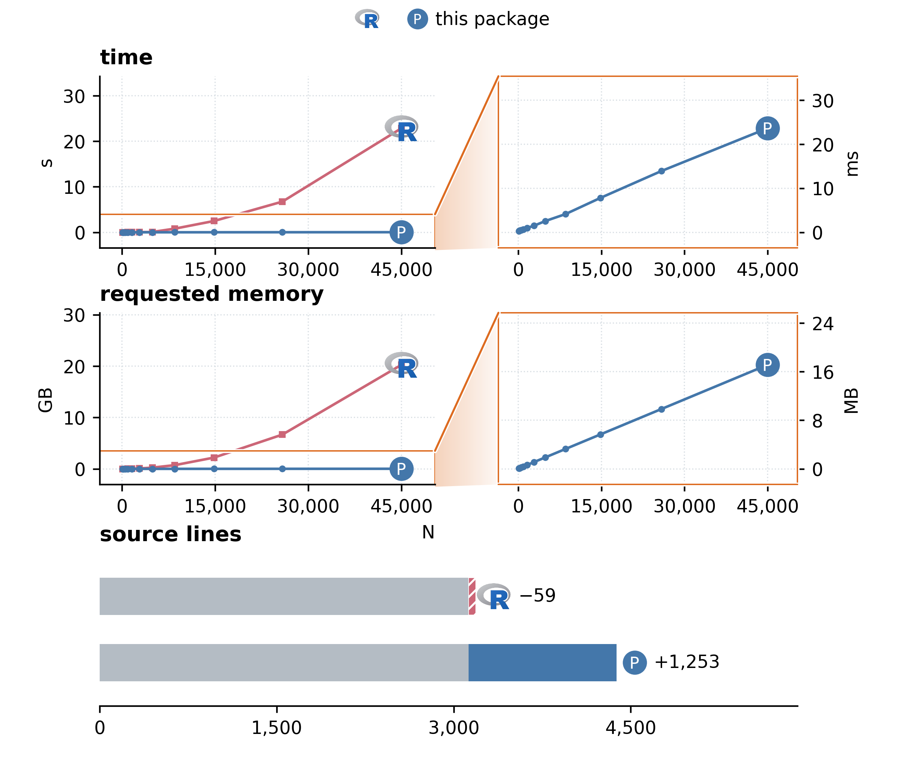

# exp_005 package source

## do the kept changes still agree with R when combined?

at N=45,000, the package is 968× faster with 1,182× less workspace.

## does priority retention remove the slow tied cases?

all 15 tied inputs beat R; the smallest speedup is 1.1×.

[how to run, inputs and outputs](docs/details.md)
