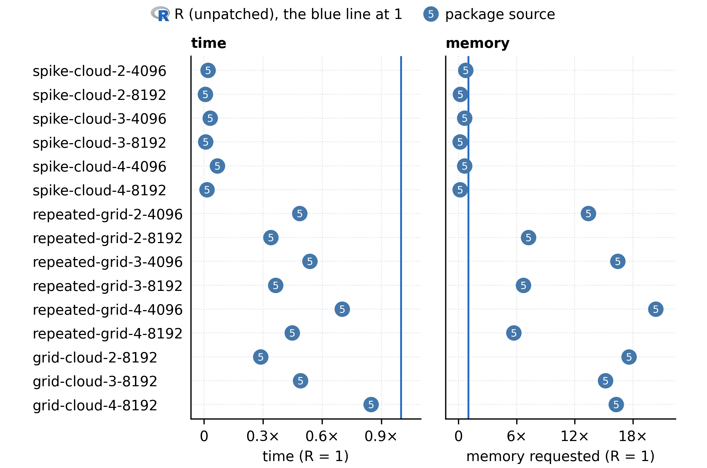
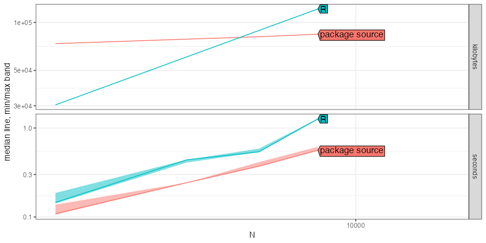

# exp_005_package_source

## question

Do the kept changes of `exp_003_reductions` still give identical output together, and does retaining zero-radius vertices first remove the slow tied inputs of `exp_004_worst_case`?

## result

Identical in 275/275 checks (256 against R, 19 against the Nov 6 patch), and faster than R on all 15 tied inputs. On 9 of them it requests 6 to 20 times more memory than R. This is the package source.

| input | memory | R | | time | R | |
|---|---:|---:|---|---:|---:|---|
| one predictor, N = 45,000 | 15.7 MB | 20.3 GB | **1,290× less** | 0.038 s | 21.8 s | **573× faster** |
| tied grid `grid-cloud-3-8192` | 87.0 MB | 5.7 MB | **15× more** | 0.62 s | 1.26 s | **2.0× faster** |
| tied grid `grid-cloud-4-8192` | 116.8 MB | 7.2 MB | **16× more** | 1.35 s | 1.59 s | **1.2× faster** |

On the tied grids a neighbourhood has 15 points, so R's own workspace is small. R was timed in a separate run, so its time ratios are rough.

One predictor, N = 45,000:


The 15 tied inputs, against R:



`grid-cloud-3` over N:



`exp_006_sparse_retention` lowers the memory on the tied inputs. [how to read the figures](../../docs/004-results.md#how-to-read-the-figures)

## how to run

```bash
Rscript experiments/exp_005_package_source/run.R
```

<details>
<summary>inputs, outputs and every number</summary>

### inputs

`shared/baseline/`, `shared/reference-nov6/`, `shared/harness/` (tied cases in `shared/harness/tied.R`), and the two patches. `variant.patch` is the package source: the package's `src/` is `shared/baseline/` with this patch. `patches/stack.patch` is the same without the retention change and is here only as the "before" side. A zero-radius vertex is one whose neighbourhood has all its observations at the same point.

`--no-profile` turns profiling off. Both builds use the source defaults, with no flags. The tied measurements use separate copies built with the test probes; the probes are not in the normal build. The run takes about 20 minutes.

### outputs

- `.results/json/summary.json` (package source; the tied comparison is under `priority_on_stack`) and `.results/json/stack-summary.json` (before side)
- `.results/tables/checks.csv`, `checks-cap-0.csv`, `timing.csv`, and the same with the prefix `stack-`
- `.results/tables/tied-comparison.csv`: the 15 tied cases, before and after, one row per case
- `.results/tables/shared-timing-comparison.csv`: the nine ordinary timing cases, before and after
- `.results/logs/`, `.results/profile/`

### findings

- Both builds: 275/275 shared cases identical with the source defaults, and 275/275 with nothing retained (`summary.json: checks`, `priority_on_stack.shared_control_checks`, `shared_stack_checks`, `shared_stack_control_checks`).
- Physical source lines against original R: +1,253 / −59 for the package source and +1,223 / −60 without the retention change (`lines-against-r.csv: variant=package/stack, part=source, added/removed`). The standalone `register.c` adapter is separate; copyright and modification notices are included.
- Tied inputs: 15/15 identical in both builds, 6/6 controls. Cases that leave a zero-radius vertex unretained at the default cap: 5 before, 0 after. The requested native bytes are the same in every pair (`summary.json: priority_on_stack.metrics`).

The 5 slow cases (`tied-comparison.csv`; seconds are user CPU of the native routine, ratios are against Nov 6):

| case | fits redone before | after | seconds before | after | ratio before | after |
|---|---:|---:|---:|---:|---:|---:|
| repeated-grid-3-8192 | 11,264 | 0 | 2.06 | 0.09 | 14.6 | 0.63 |
| repeated-grid-4-4096 | 6,784 | 0 | 1.22 | 0.14 | 7.0 | 0.78 |
| repeated-grid-4-8192 | 24,320 | 0 | 4.93 | 0.22 | 15.3 | 0.72 |
| grid-cloud-2-8192 | 47,616 | 0 | 22.36 | 0.37 | 36.0 | 0.58 |
| grid-cloud-3-8192 | 12,544 | 0 | 30.68 | 0.62 | 38.4 | 0.79 |

Across runs the after column has ranged from 0.57 to 0.92.

What this does not change: on these 5 inputs the public `predict(se = TRUE)` still stops with the same error as R. The change removes redone work inside the native routine.

One case is still slower than the Nov 6 patch: `grid-cloud-4-8192`, at 1.17 times the Nov 6 time in this run and 1.11 to 1.30 across runs (1.35 s against 1.15 s here). It has no zero-radius vertex; 5,699 vertices are needed and 204 fit under the cap, so the rest are rebuilt. Its public prediction works, and it requests 117 MB against 276 MB for the Nov 6 patch. Where its time goes is not located yet.

Ordinary timing, with against without the retention change: the nine ratios range from 0.93 to 1.16 in this run and from 0.90 to 1.19 across earlier ones (`shared-timing-comparison.csv: priority_to_stack_ratio`), which is within the run-to-run variation of the shared machine on cases this short.

The experiment times the Nov 6 patch on the tied inputs; `docs/figures/result/r-tied.R` measures R on all of them.

</details>
