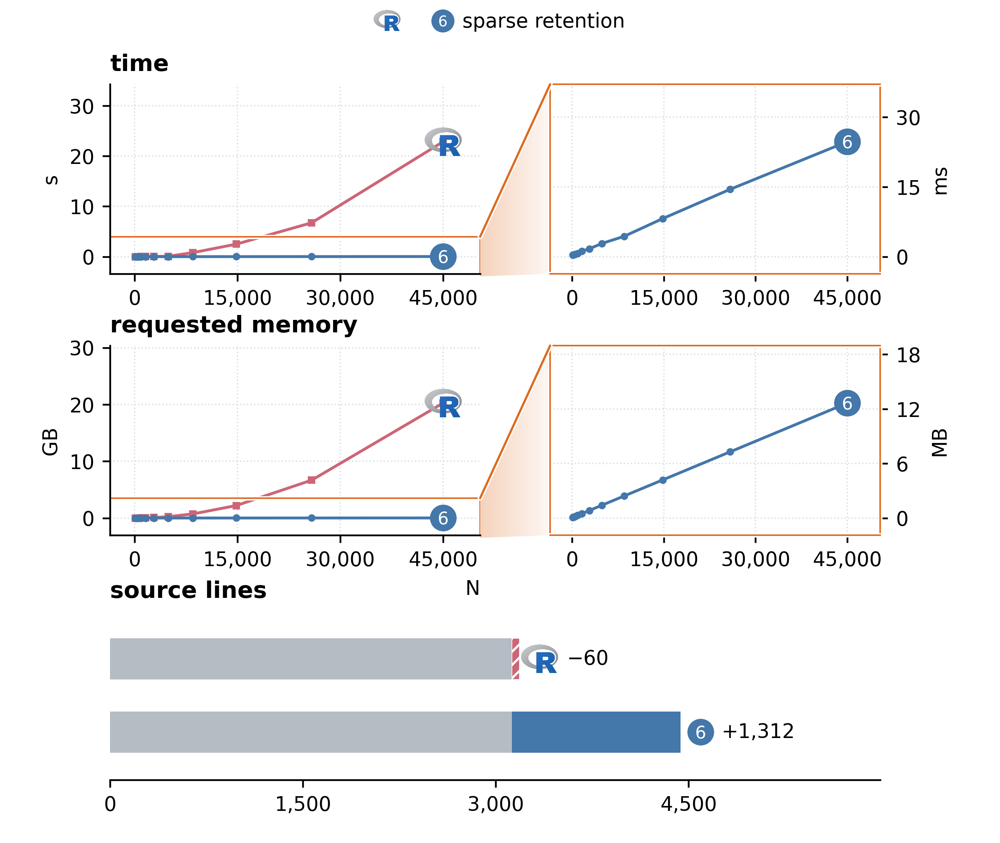
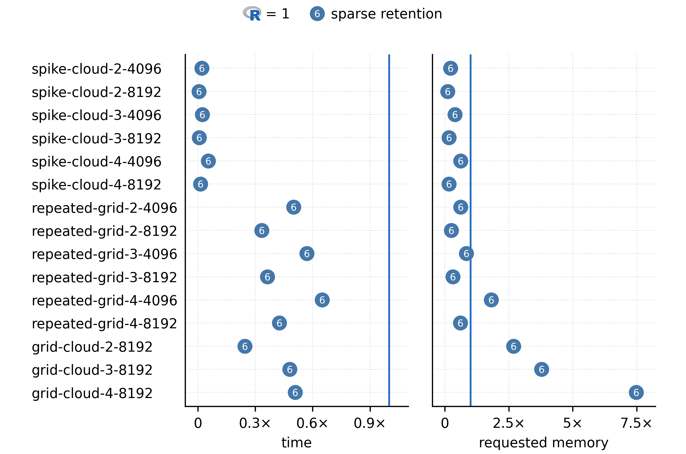

# exp_006 sparse retention

## can retained vertices store only their nonzero neighbourhood coefficients?

at N=45,000, sparse retention is 925× faster with 1,601× less workspace.

## does sparse retention solve the tied-input memory excess?

all 15 tied inputs beat R; the last grid still requests 7.5× R's workspace.

[how to run, inputs and outputs](docs/details.md)
