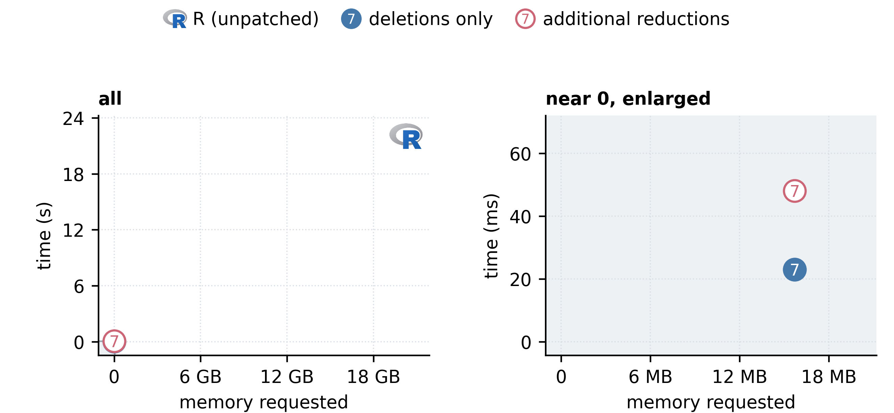

# exp_007_shorter_source

## question

How much package source can be removed without slowing ordinary predictions, and which extra reductions trade speed for fewer lines?

## result

`deletions_only` removes unused or redundant package code: unused routines (`a-unused`), unrelated declarations (`b-header`), fitting entries (`c-fit-only`), the duplicate direct predictor (`k-direct-delegate`), and response-solving code left unreachable by those deletions (`o-dependent-cleanup`). It saves **1,225 physical lines** and preserves the common-case time here. The project package is unchanged.

`reduced` also unifies geometry plans, shares design-row expressions, uses existing BLAS vector updates and delegates fitted values to public stats prediction. It saves another 239 lines, but its one-predictor cases are 2.00 to 3.88 times slower than the package. It remains here only as the requested size-versus-speed comparison, not a usable package-source replacement.

| quantity or timed input | package | deletions_only | reduced | R |
|---|---:|---:|---:|---:|
| physical source lines | 3,982 | 2,757 | 2,518 | — |
| line changes from the package | — | +27 / −1,252 | +86 / −1,550 | — |
| one predictor, 20,000 observations, 80 predictions; public | 0.010 s | 0.010 s | 0.021 s | 4.373 s |
| one predictor, 45,000 observations, 80 predictions; public | 0.024 s | 0.023 s | 0.048 s | 22.052 s |
| one predictor, 2,000 observations, 2,000 predictions; public | 0.008 s | 0.008 s | 0.031 s | 0.126 s |
| tied grid, four predictors, 8,192 observations; native | 1.490 s | 1.568 s | 2.450 s | 1.705 s |
| native bytes, one predictor, 45,000 observations | 15,701,128 | 15,701,128 | 15,701,128 | 20,254,860,600 |



The filled circle marked 7 is `deletions_only`, the primary build; the outlined circle is `reduced`, with the additional reductions. The right panel enlarges the grey near-zero range; both axes are linear.

Both variants pass 275/275 shared comparisons at the default retention cap and at cap zero. The unchanged `tests/predict-se.R` passes 324 prediction comparisons plus the invalid-object error comparison for each variant at each cap. All nine ordinary and fifteen tied native inputs are strictly identical to R, including warnings and NaN bit patterns. Eight tied public predictions stop with the same error as R; their native variances are still compared. Requested standard-error bytes match the package on all 24 inputs.

### what costs time

Each item below is added alone to `deletions_only`, then timed on the three one-predictor cases. Ratios are against `deletions_only`; each call is batched twenty times over nine interleaved rounds.

- `d-unified-plan`, using the general geometry plan in one dimension: **1.88 to 3.94 times**. This is the main slowdown.
- `p-canonical-ifit`, obtaining fitted values through public stats prediction: **1.04 to 1.18 times**. It adds a smaller cost.
- `e-shared-features`, one function for production and reconstructed design rows: **0.994 to 1.056 times**.
- `g-blas-axpy`, three vector updates through the already-linked BLAS library: **0.990 to 1.015 times**. BLAS is the basic linear algebra library.

The five deletion stages show no material one-predictor penalty: their cumulative times stay within about two percent of the package. They are not cost-free everywhere. On the four-predictor tied grid, the final cleanup `o-dependent-cleanup` takes 1.437 s after 1.405 s before it, a 2.3 percent increase in a five-round follow-up. The main comparison above has a 5.2 percent difference between `deletions_only` and the package on that input. Short timings vary on this shared machine; raw rounds are retained.

### the rejected arithmetic reduction

`f-fused-sum`, which removes the temporary array of double values, is absent from both variants. Alone and in the earlier full combination it changed 126 of 256 NaN bit patterns on `repeated-grid-2-4096`, a repeated two-predictor grid with 4,096 observations. The 275 and 324 checks passed that combination because public prediction stops before reaching the native variance entry. The strict tied native comparison caught it. The original separate reduction loop is retained. Raw values and the failed combination remain in `.results/diagnostics/native-nan-check.rds` and `.results/diagnostics/bisect/`.

### limits

The unchanged native harness inherits stats fitting entries after the local entries are deleted. Its 275 passing comparisons cannot verify the removed local fitting code. The installed-library mode of `shared/harness/check.R` instead fits with `stats::loess` and predicts with each installed `loesslin::predict_se`, covering the package's own R wrapper.

The 1,225-line deletion is specific to this standalone package: complete R stats still needs its fitter, direct predictor and declarations. The extra algorithm reductions in `reduced` are not an upstream patch recommendation: the common geometry plan fails the common-case speed requirement, and the remaining arithmetic changes still need an actual stats build and platform checks. Public prediction cannot delegate recursively to itself inside stats. Custom loess subclass dispatch, other BLAS libraries and other compilers are not covered. There is no new dependency.

## how to run

```bash
Rscript experiments/exp_007_shorter_source/run.R
```

Use the project's R and C/Fortran toolchain. The entry builds both variants and all four attribution additions. Every installation stays under this experiment's `.intermediates/library-*`. `--no-profile` disables profiling; otherwise the entry and each R worker write separate `Rprof()` files. Sourcing the entry starts no work. OpenBLAS and OpenMP use one thread.

<details>
<summary>inputs, outputs and counting scope</summary>

### inputs and method

`patches/deletions-only.patch` and `variant.patch` apply independently to copies of the current package. `patches/add-*.patch` apply individually to `deletions_only` and exist only to attribute the four excluded changes' costs. No patch is applied to the project package.

`shared/harness/` supplies the same nine ordinary and fifteen tied inputs as the other experiments. The nineteen historical comparisons use `shared/reference-nov6/`; the other 256 compare with installed R. `shared/reference-r/` supplies the original R line-count reference.

All timed package methods use their own source R wrapper bound to their own installed native library, so they can run in alternating order in one R process. Namespace checks and package tests load each real installed package in its own process. Timings are median user CPU seconds: five rounds for ordinary inputs with more than 5,000 observations, nine for other ordinary inputs and three for tied native inputs. The four additions use nine rounds of twenty calls. The separate deletion-stage follow-up uses the same batching for ordinary cases and five native rounds for the tied grid.

Memory probes are separate builds. Their outputs must match every uninstrumented variant strictly. The byte table counts the standard-error kernel's native workspace; R's returned observation-by-prediction matrix is separate. It excludes fitting, the separate fitted-value call, other R objects and peak resident memory. The retention cap limits retained coefficient arrays, not total requests.

### line-count scope

The physical counts include copyright and modification notices. Against original R, `deletions_only` is +1,277 / −1,748 source lines and `reduced` is +1,187 / −1,896 (`lines-against-r.csv: variant, part=source, added/removed`). The package itself is +1,333 / −576 under this wrapper-mapping scope.

`source-lines.csv` includes native sources, headers, registration, Makevars, `R/predict-se.R` and all copyright notices, with a `variant` column. `summary.json: variants.<name>.source_lines` records changes from the package.

`lines-against-r.csv` has `experiment,variant,part,added,removed` rows for `package`, `deletions_only` and `reduced`. Recount without rebuilding from `.intermediates/line-count/<name>/` against `shared/reference-r/`. Package `src/NAME` maps to R's same-named file; **package `R/predict-se.R` maps to R's complete `loess.R`**. This includes the omitted R fitting wrapper. New native files count as additions, `register.c` is a separate build adapter, and `total` includes it. This comparison counts `.c`, `.f`, `.h` and `.R`, excluding Makevars and package metadata.

### outputs

- `.results/json/summary.json`: both variants, cap checks, timing ranges, additions and counting scope; `reduction-scope.json` identifies the selected and rejected candidates.
- `.results/tables/source-lines.csv`, `lines-against-r.csv`: physical lines and original-R differences.
- `.results/tables/checks-<variant>-default.csv`, `checks-<variant>-cap-0.csv`, `checks-unchanged-native-<variant>.csv`; `.results/json/tests-<variant>-<cap>.json`: complete shared and installed-package checks.
- `.results/tables/ordinary-timing.csv`, `tied-timing.csv`, `timing-rounds.csv`: simultaneous package, two-variant and R comparisons. `source_s` is the package time.
- `.results/tables/addition-timing.csv`, `addition-rounds.csv`: one-at-a-time additions; `deletion-stages.csv`, `deletion-stage-rounds.csv`: the five deletion stages.
- `.results/tables/requested-bytes.csv`: `package_native_bytes`, `deletions_only_native_bytes`, `reduced_native_bytes`, `r_native_bytes`, `r_L_bytes` and `r_native_and_L_bytes`, joined to timing by `id`.
- `.results/diagnostics/`, `.results/logs/`, `.results/profile/`: compared values, build and worker logs, and actual-work profiles.

Every build and result belongs to this experiment. No experiment reads another experiment's private products.

</details>
