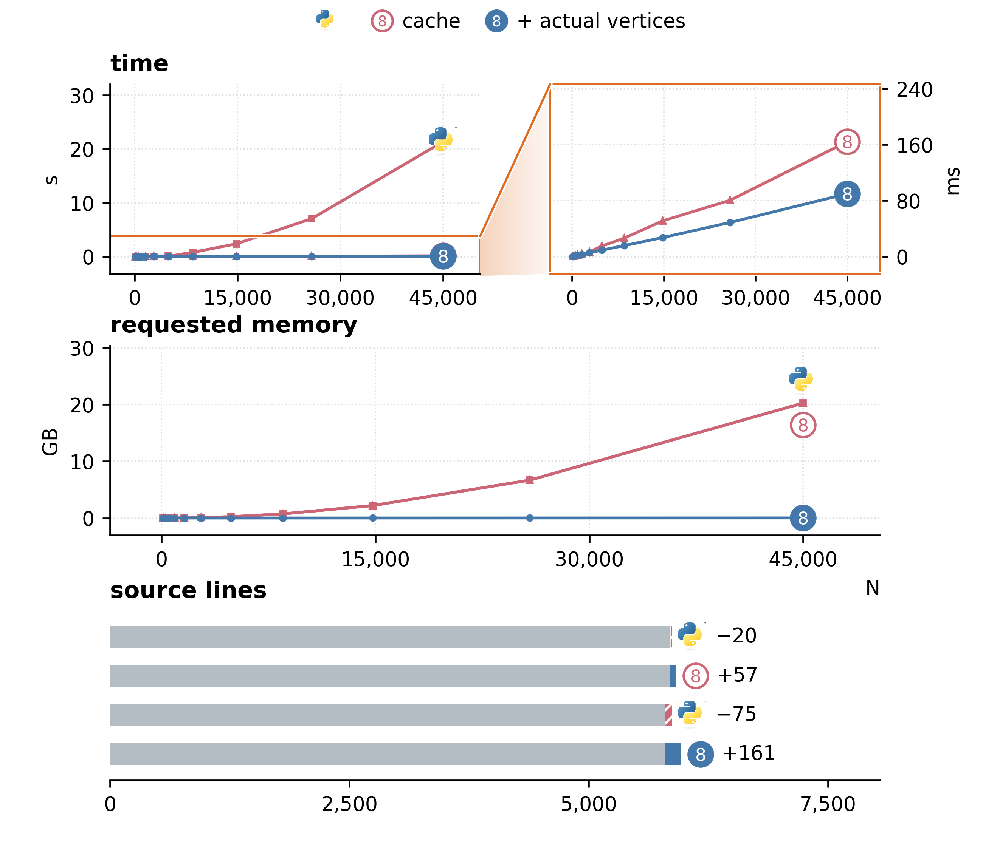

# exp_008 Python scikit-misc

## do caching and actual-vertex storage preserve Python predictions?

Python builds match bit for bit: 238× faster, 1,301× less workspace, and about 1e-14 agreement with R.

[how to run, inputs and outputs](docs/details.md)
